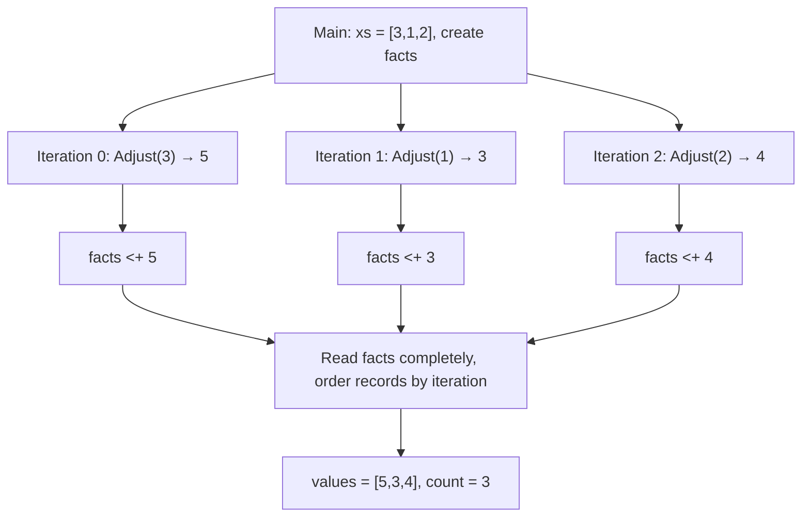

# LIP 1.0

[简体中文](README.md) | [English](README.en.md)

**Compute with values. Organize work as a graph. Build results from facts.**

LIP is a small language for composable computation, parallel analysis, and tool collaboration. Pure functions compute values, Flows organize dependent work, Claims collect facts with provenance, and effect / perform connects external capabilities. Together they describe the whole journey from input to result: what can run concurrently, when a result is complete, and how external actions take place.

The focus is a solid computational core. Math, files, networking, databases, and models come through the **Go / Python ecosystems**. Interactive exploration and generated Go share the same value, dependency, identity, and call rules. LIP fits programs that break down tasks, collect evidence, call tools, and produce an explicit conclusion.

[Language specification](spec/LIP-1.0-SPEC.md) · [Example tutorial](examples/README.md) · [Implementation and validation](IMPLEMENTATION.md)

## One program, the whole model

This is the core of [26_flows.lip](examples/advanced/26_flows.lip):

```lip
export OFFSET:number = 2
fn add(value:number, delta:number)->number { value + delta }

export flow Adjust(value:number)->number {
    return value |> add(delta=OFFSET)
}

flow Main(xs:list)->object {
    facts = claim()
    for x in xs parallel {
        result = x |> Adjust
        facts <+ result
    }
    return {values:[row.value for row in facts], count:facts |> len}
}
```

```sh
make build
./lipc run -entry Main -parallel 4 -input '{"xs":[3,1,2]}' examples/advanced/26_flows.lip
# {"count":3,"values":[5,3,4]}
```

This program adds 2 to each input, allows the iterations to run concurrently, and collects results in input order. Its four declarations have distinct roles:

| Declaration | Role in the program | Accessible from other LIP modules? |
|---|---|---|
| `OFFSET` | Immutable module-level static data with value `2`; `number` is its type annotation | Yes, through `export` |
| `add` | A pure function computing the sum of two numbers | No, private by default |
| `Adjust` | A reusable Flow template using `add` and `OFFSET` | Yes, through `export` |
| `Main` | A Flow template that creates a Claim, expands the loop, and collects results | No; `-entry Main` selects it as this run's root entry |

### How `OFFSET` connects modules and computation

Each `.lip` file is a module. Uppercase `OFFSET` is a naming convention; its value is fixed in the code and included in the build snapshot. `export` controls visibility outside the module; `-entry` selects the entry point.

Another file at the project root can use `import lip "./examples/advanced/26_flows.lip" as adjust`, then read `adjust.OFFSET` or call `x |> adjust.Adjust`. The importer chooses the namespace alias `adjust`. The imported `Adjust` always uses `OFFSET` and the private function `add` from its **defining module**. Local values with the same names in the caller do not change its computation. Removing `export` from `OFFSET` would still let `Adjust` use it within this module; external reads of `adjust.OFFSET` would be rejected. See [Child Flows, pipelines, and static modules](#child-flows-pipelines-and-static-modules) for the complete two-file example.

### From declarations to a running result

At build time, the tool freezes the source and imported dependencies, then collects and checks static data, functions, and Flow declarations. Imports establish module relationships; the bodies of `Main` and `Adjust`, including `claim()`, execute when called.

This run establishes the following work and dependencies:

1. `-entry Main` selects the entry point, and the JSON input binds `[3,1,2]` to `xs`. After input validation, a run is created. The `Main` instance creates **one `facts` Claim shared by all three iterations**.
2. The `for` source `xs` is evaluated once, and three iterations expand in original index order. Each `result = x |> Adjust` instantiates its own `Adjust` subgraph, with separate parameters and structural identity. In the first iteration, the pipeline fixes `3` and passes it to `Adjust(value=3)`. Inside that Flow, `value |> add(delta=OFFSET)` computes `add(value=3, delta=2)`, producing `5`. The pure function `add` computes a value within the current node.
3. Each `facts <+ result` waits for its corresponding subgraph to succeed completely, then submits a record to the shared Claim. The three iterations contribute `5`, `3`, and `4`; their work can interleave.
4. The final `return` reads `facts` completely, waiting for all contribution work. The snapshot orders records by logical position: iterations 0, 1, and 2 in this example. `row.value` extracts each record's value, and `len` counts the records. Once the entire entry graph succeeds, the Host receives `{"count":3,"values":[5,3,4]}`.

This diagram shows the example's value dependencies; each `Adjust` box contains its own subgraph:



Thus `[5,3,4]` preserves input position; neither numeric order nor completion timing changes that order. `|>` evaluates its left side once and completes each stage before entering the next. Pure function stages compute within a node; Flow stages instantiate subgraphs.

`-parallel 4` allows at most four active leaf evaluations across the entire run. Parent and child graphs share one scheduler and budget. Containers waiting for children yield their worker slots so the scheduler can execute child nodes. Set the limit to `1`, and the same program still completes with the same result.

## What makes LIP distinctive

### Values and work each have a clear expression

A `fn` is a pure function capturing immutable values, suitable for transformations, validation, recursion, and reduction. A `flow` is a reusable graph template for dependencies, branches, loops, and external calls. Bindings connect results. A successful child Flow means its entire selected subgraph has completed, including work beyond the return expression. Receiving the result also establishes that the stage has finished.

Pure functions support proper tail calls, including direct, mutual, and indirect recursion. Flows repeat work with explicit loops. Local expressions and arguments evaluate from left to right; independent graph nodes follow dependencies and operation contracts. Program structure explains both sequence and concurrency.

### Claim gives parallel collection a completion boundary, provenance, and order

`claim()` creates an append-only collection of facts; `<+` submits contributions with structural identities. An identical contribution under the same identity can be delivered again. Equal values under different identities remain distinct facts. A complete read waits for all producers, then returns records containing values and source positions.

Counts, missing evidence, rankings, scores, and final reports are ordinary pure projections. Fact collection and business decisions can be reused independently, while each result remains traceable to its contributing work. Use a live snapshot for a single immediate observation; read the Claim directly for a complete conclusion.

### Every external action follows one protocol

`effect` fixes an operation and its arguments into a request value. `perform` handles admission, invocation, and recording. Host contracts declare schemas, versions, permissions, effects, concurrency, and resource requirements. The runtime uses them to overlap eligible reads and preserve ordering around writes.

Direct Go/Python library calls lower to this protocol too. Interactive convenience, explicit operation contracts, and generated programs share the same external call path. Argument and authorization checks precede actual operations.

### Dynamic work has stable structural identity

Loop iterations, child Flows, contributions, and calls derive identities from source positions and dynamic paths. These identities connect diagnostics, Claim provenance, and call records without numbering work by arrival or completion. Modules are frozen into one source snapshot at build time; source contents, versions, and dependency resolution determine its build identity.

Under the specification's conditions—fixed inputs and external responses, fair and finite termination, no live snapshot, and no cancellation or budget interference—legal schedules produce the same successful result or primary error. Claim order and structural identities make those results inspectable. See [specification §13](spec/LIP-1.0-SPEC.md#13-确定性与保证边界) for the complete conditions.

### One program, from exploration to a Go executable

The REPL, 18 bundled lessons, file execution, and Go generation use one core. The generator compiles expressions into dedicated Go evaluation functions and includes the scheduler and Host runtime. Generated programs execute those functions directly, without parsing LIP source again or reading the source directory.

These LIP 1.0 mechanisms are implemented in an executable compiler and runtime. Tests build and run generated programs, comparing outputs, errors, identities, and call boundaries. Composition tests combine modules, closures, loops, child graphs, and pipelines at worker limits 1, 2, and 4. [Implementation and validation](IMPLEMENTATION.md) maps specification sections to concrete tests.

## Getting started

Use **Go 1.25 or newer**. Basic Python examples use the Python 3 standard library; scientific examples require the respective packages in the active Python environment. From the project root containing `go.mod`:

```sh
make build
./lipc run examples/basics/01_hello.lip
# "Hello, LIP!"
./lipc run -parallel 4 examples/evidence.lip
# {"missing":["b","c"]}
./lipc repl
./lipc learn -lesson flows
```

Install the command to use the bundled runtime and lessons from other directories:

```sh
go install ./cmd/lipc
export PATH="$(go env GOPATH)/bin:$PATH"  # Default location when GOBIN is empty.
lipc help
lipc learn -list
```

If GOBIN is set, add that directory to PATH. A custom location can be selected with `GOBIN="$HOME/.local/bin" go install ./cmd/lipc`. Save PATH in your shell configuration; on Windows, configure user PATH and use `lipc.exe`. The current Go module name is `lipbeta`; these installation commands use local source.

## Language core and program structure

Bindings are immutable; inner scopes can shadow ordinary names. Values include null, bool, finite binary64 numbers, UTF-8 strings, lists, objects, pure functions, and requests. **Data** recursively excludes functions and requests and is the boundary format for Flows, Hosts, and Claims. An `any` annotation still requires the type and Data checks of its eventual use.

| Work to express | Syntax |
|---|---|
| Pure transformation | `fn twice(x:number)->number { x * 2 }` |
| Conditions and dispatch | `if ... { ... } else { ... }`, `match` |
| List transformation and reduction | Comprehensions, `map`, `fold` |
| Carry a result between iterations | `for x in xs with total=0 { next total+x }` |
| Independent work and fact collection | `for x in xs parallel { facts <+ x*x }` |
| Structured stages | `x |> Adjust |> Finish` |
| External request and execution | `request=effect op(args)`, `perform request` |

Arithmetic includes `+ - * / // % ** */`. Exponentiation `**` associates right: `2 ** 3 ** 2` is 512, `-3 ** 2` is -9, and `2 ** -3` is 0.125. `8 */ 2` is the logarithm of 8 with base 2, yielding 3. Powers and logarithms use fixed binary64 approximation algorithms; domain errors and non-finite results raise `E-NUMBER`. See the [tutorial](examples/README.md) for numerical, string, and control-structure examples.

### Entry points and successful results

Files can declare static literal Data, pure functions, and multiple Flows. A sole root Flow is selected automatically; use `-entry` with multiple Flows. All declarations in the source closure are checked, including unselected ones.

```lip
BASE:number = 2
fn add_base(x:number)->number { x + BASE }
flow Add(x:number)->number { return add_base(x) }
flow Empty()->void {}
```

Save as `program.lip`, then run:

```sh
./lipc run -entry Add -input '{"x":3}' program.lip
# 5
./lipc run -entry Add -entry-input '{"positional":[3],"named":{}}' -entry-output program.lip
# {"kind":"value","value":5}
./lipc run -entry Empty -entry-output program.lip
# {"kind":"void"}
```

`-input` takes a JSON object of named arguments; `-entry-input` takes the full EntryInput. They are mutually exclusive. Validation happens before allocating a run_id, journal, or graph; invalid inputs raise `E-SCHEMA`. Default output is JSON. `-entry-output` preserves the success envelope, distinguishing void from a returned null, `{"kind":"value","value":null}`. Successful output waits for the entire graph. Logging and file writes are external operations; the teaching Host writes console output to stderr, keeping stdout for results.

### Child Flows, pipelines, and static modules

Child Flows receive context through parameters; bindings and Claims belong to individual instances. Explicit Flow arguments must be Pure Data. Use a binding or pipeline when another call must complete first. Flow targets are static; recursive Flow call graphs are rejected at compile time.

Pipeline stages are named functions, Flows, exported module functions/Flows, or core pure functions. Function values and native library functions use ordinary calls. `|>` binds less tightly than `||`; compare stage results with `(x |> F) == y`. Business values such as `{ok:false}` are ordinary Data; use `if` or `match` to decide what follows.

Modules publish declarations with `export` and use their own static data, functions, and imports. Save this `reuse.lip` at the project root to reuse the opening example:

```lip
import lip "./examples/advanced/26_flows.lip" as adjust
flow Main(xs:list)->list {
    return [x |> adjust.Adjust for x in xs]
}
```

```sh
./lipc run -input '{"xs":[3,1,2]}' reuse.lip
# [5,3,4]
```

`run`, `emit-go`, `build`, and `serve` freeze the complete dependency closure. `-project` selects the project root, defaulting to the entry file's directory. Symlinks below the root, escaping paths, and duplicate physical files are rejected. Builds allow up to 4,096 sources and 64 MiB total. LIP module imports resolve declarations; rebuild after source changes.

## Connecting Go / Python

CLI file execution, builds, and the REPL enable the generic library bridge by default. Call libraries in the current Go/Python environment, or register Host contracts with explicit schemas, effects, and concurrency guarantees.

```text
In [1]: import go "strings"
In [2]: strings.ToUpper("hello, lip")
"HELLO, LIP"
In [3]: import go "bytes"
In [4]: buffer = bytes.NewBufferString("hello")
<go *bytes.Buffer>
In [5]: buffer.WriteString("!")
1
In [6]: buffer.String()
"hello!"
In [7]: import python "math"
In [8]: math.sqrt(9)
3
```

Direct calls, methods, and attribute reads lower to ordinary `perform effect` before checking. Constructing an `effect` only saves the request. Generic operations are Unknown and follow write restrictions. Explicit registrations take precedence; `parallel` admits only operations declared Concurrent ReadOnly.

The [teaching Host](script/adapters.go) demonstrates parallel reads and sequential writes through explicit contracts:

```sh
./lipc run -host demo -parallel 4 examples/ecosystem/19_parallel_read_write.lip
# ["ADA","LIN","SAM"]; console logs go to stderr.
./lipc run -host demo examples/ecosystem/17_go_python.lip
# {"digest":"a615eeaee21de5179de080de8c3052c8da901138406ba71c38c032845f7d54f4","mean":2}
```

Multi-round tool programs progress through “think → call → observe → decide again.” [recorded_iteration](examples/ecosystem/20_recorded_iteration.lip) passes recorded responses into the next iteration; [evidence](examples/evidence.lip) collects complete evidence; [refine](examples/refine.lip) carries values through iterative improvement. Models and business tools can use the same Host contracts. The Host receives ongoing events and starts independent runs for them.

### Third-party libraries and runtime environment

Go imports use full, case-sensitive package paths. The working directory's Go module resolves dependencies:

| Library | Import |
|---|---|
| Gonum matrices | `import go "gonum.org/v1/gonum/mat" as mat` |
| Gorgonia | `import go "gorgonia.org/gorgonia" as gorgonia` |
| Gin | `import go "github.com/gin-gonic/gin" as gin` |
| Viper | `import go "github.com/spf13/viper" as viper` |

Configure your project in the terminal, then start the installed lipc:

```sh
mkdir analysis
cd analysis
go mod init example.org/analysis
go get gonum.org/v1/gonum/mat
lipc repl
```

```text
In [1]: import go "gonum.org/v1/gonum/mat" as mat
In [2]: m = mat.NewDense(2,2,[1,2,3,4])
<go *mat.Dense>
In [3]: m.At(1,0)
3
```

With an existing `go.mod`, configure dependencies directly. Imports and completion neither execute library initialization nor install dependencies. Go export discovery uses the toolchain; Python loads modules on the first actual operation. Automatic Go adapters require the Go toolchain, CGO, and Go plugin support (Linux, macOS, FreeBSD). Generic Go functions are instantiated from actual argument types; register application-specific types and instances that cannot be inferred explicitly.

Python uses a persistent worker and a separate protocol channel, retaining modules and objects in the current environment:

```text
In [1]: import python "numpy" as np
In [2]: import python "scipy" as sp
In [3]: a = np.array([1,2,3], dtype=np.int64)
<python numpy.ndarray>
In [4]: a.reshape(3,1).tolist()
[[1],[2],[3]]
In [5]: sp.linalg.norm(a)
3.7416573867739413
```

Module attributes, submodules, classes, methods, named arguments, and native function references use the same bridge. `help()`, `help(module)`, `help(module.member)`, and `help(value)` provide interactive guidance, library documentation, and Go export signatures. `help("math.sqrt")` queries Python documentation. Without `as`, the final path component becomes the name. Go's string package is `strings`.

### Values and resources

| Value or operation | Bridge behavior |
|---|---|
| null, bool, finite number, string | Ordinary Data; native integers must convert exactly within the supported range |
| LIP list / object | Convert to the Go target type or Python list / dict |
| Ordinary Python list / tuple / string-keyed dict | Language containers, potentially containing resource references |
| Go containers, structs, pointers, functions; Python arrays, DataFrames, bytes, etc. | Resource references scoped to the Host |
| `native_data(value)` | A finite, acyclic Data snapshot through perform; supports Go containers/exported fields and Python containers/`tolist()` |
| `native_release(value)` | Release that reference; close files and similar resources with their own methods |

Go numbers are checked against target integer ranges; string-to-`[]byte` conversion uses UTF-8. Safe integral Python arguments become int; other numbers become float. Take snapshots or encode bytes to cross Go/Python runtimes. Non-finite numbers and cyclic objects cannot become Data. A trailing error among multiple Go results is the failure channel; a sole error result remains a native resource, with nil as null. Native function references can be passed within a runtime; language pure functions need an application adapter to serve as native callbacks. The `native_data` / `native_release` helpers follow lexical name resolution; local declarations take precedence.

The Host owns workers, objects, and permissions. Closing or resetting invalidates existing references. Cancellation or lost communication never automatically repeats an external action. Native libraries have their process or worker's OS permissions; applications supply deployment isolation when needed.

## Interactive computation and learning

```sh
./lipc repl
./lipc repl -host demo
./lipc learn
./lipc learn -list
./lipc learn -lesson modules
```

The REPL retains values, pure functions, and closures from successful cells. Historical actions run once. Failed cells commit no new bindings; external actions already performed remain. Each cell is an independent run. Named functions can serve as pipeline stages across cells:

```text
In [1]: x = 6
6
In [2]: fn twice(n:number)->number { n * 2 }
In [3]: x |> twice
12
```

Complete Flows, static Data declarations, and LIP modules use the file path through `:run`:

```text
:run -entry Main -input '{"xs":[3,1,2]}' examples/advanced/26_flows.lip
:run -entry Add -entry-input '{"positional":[3],"named":{}}' -entry-output "path with spaces/program.lip"
```

`:run` accepts normal file options for entry, project root, and inputs, inheriting the session Host by default. File runs are independent of REPL bindings. Single/double quotes group paths or JSON; command arguments are parsed literally. `:vars` shows values, `:history` shows inputs, `:reset` clears the session, `:cancel` discards a draft, and `:quit` exits. Piped input automatically hides prompts:

```sh
printf 'x=6\nx*2\n:quit\n' | ./lipc repl
```

The REPL and learn share an editor:

| Keys | Action |
|---|---|
| ← / →, Ctrl-B / F; Home / End, Ctrl-A / E | Move or reach line boundaries |
| Alt-B / F, Ctrl-← / → | Move by word |
| Backspace / Delete, Ctrl-D | Delete; Ctrl-D exits on empty input |
| Ctrl-U / K / W, Alt-D; Ctrl-Y | Cut to start/end, previous/next word; paste back |
| Ctrl-_ (often Ctrl-/); Ctrl-T | Undo; transpose nearby characters |
| ↑ / ↓, Ctrl-R | History and search; Ctrl-G cancels search, Enter submits |
| Tab; Ctrl-L; Ctrl-C | Complete; clear screen; discard input and draft |

Open brackets, braces, and triple-quoted strings support multiline input; otherwise use a trailing `\`. The editor supports bracketed paste, Chinese text, and common combining characters. Raw mode applies only during editing and is restored before provider calls; pipes use plain text. Terminal interfaces support Linux, macOS/BSD, and VT-enabled Windows consoles; current platform validation is Linux.

The 18 lessons cover values and arithmetic, functions, entries, child Flows/pipelines, modules, control structures, Claims, and tools. Enter an answer to validate it; `:hint` gives guidance, `:demo` runs the example, and `:next` advances. `:edit` / `:submit` edits and submits a complete program. Lessons check multiple inputs; module sources are bundled for learning away from the repository. Progress is saved only when requested:

```sh
./lipc learn -progress /path/to/progress.json
```

## Generating Go programs

```sh
./lipc build -entry Main -o .build/flows examples/advanced/26_flows.lip
./.build/flows -input '{"xs":[3,1,2]}'
# {"count":3,"values":[5,3,4]}

./lipc emit-go -o .build/hello.go examples/basics/01_hello.lip
go build -o .build/hello .build/hello.go
./.build/hello
# "Hello, LIP!"
```

Generated programs fix the entry and source snapshot and accept `-input`, `-entry-input`, `-entry-output`, `-parallel`, `-steps`, and `-elements`. They verify Host contracts at startup. Pure core programs and the Go portion of the teaching Host use only the standard library. Python operations require their runtime environment; automatic Go adapters still require the toolchain, CGO, and plugins.

Use the Makefile for project-local caches:

```sh
make compile SOURCE=examples/ecosystem/17_go_python.lip HOST=demo OUTPUT=.build/interop
./.build/interop -parallel 4
```

`make compile` also accepts `ENTRY` and `PROJECT`. Adapters and compilation need writable temporary space. `make build/test/race/vet` configure caches under `.build`; direct Go commands can set `GOTMPDIR` / `TMPDIR`. Recreate those directories after `make clean`.

## Websites and HTTP integration

The HTTP Host converts requests to Data and runs a Flow independently for each request. Entries have the form `flow Name(request:object)->object`:

```sh
./lipc serve examples/web/23_home.lip
# http://127.0.0.1:8080/
./lipc serve -route 'POST /api/echo' examples/web/24_echo.lip
curl -H 'Content-Type: application/json' -d '{"name":"Ada"}' http://127.0.0.1:8080/api/echo
```

Requests provide method, path, raw_path, host, params, query, headers, body, and json. Repeated query/header values are preserved, header keys are lowercase, and bodies explicitly use utf-8 or base64. Responses contain status, optionally json or body, and headers with string or string-list values. Triple-quoted strings can contain HTML; use an escaping template library for dynamic content. See [23_home.lip](examples/web/23_home.lip).

Configure multiple routes with `./lipc serve -routes routes.json`. Source paths are relative to the manifest, and each route can select an entry:

```json
[
  {"pattern":"GET /{$}","source":"examples/web/23_home.lip"},
  {"pattern":"POST /api/echo","source":"examples/web/24_echo.lip"},
  {"pattern":"GET /api/hello/{name}","source":"examples/web/25_greeting.lip"}
]
```

Routes use explicit-method ServeMux patterns; compilation and conflict checks happen before listening. HEAD matches only explicit HEAD routes, and a 405 Allow header lists only configured methods. For `/{x}` matching `/a%2Fb`, path is `/a/b`, raw_path is `/a%2Fb`, and params.x is `a/b`. Runs, Claims, records, budgets, and cancellation are isolated per request; responses commit after validation succeeds.

Defaults are 30 seconds, 1 MiB each for request/response bodies, 8 MiB each for canonical Data, and 64 concurrent requests across routes. CLI options are `-timeout`, `-concurrent`, `-body-bytes`, `-response-bytes`, `-parallel`, `-steps`, and `-elements`; zero selects defaults. Embedded configuration also provides `HTTPOptions.MaxDataBytes`.

`serve` uses pure core or explicit teaching contracts with `-host demo`. Embed through `NewHTTPHandler` / `NewHTTPMux` and application authentication middleware. Authorization and operations receive the same context; applications own Hosts and connection pools. `HTTPOptions.OnError` receives server diagnostics while public errors use fixed categories. HTTP uses explicit Host operations; the generic native bridge currently serves files, sessions, and generated programs. See [specification §12.1](spec/LIP-1.0-SPEC.md#121-可选-http-host-接入).

## Embedding and build identity

The Go import path is `lipbeta/script`:

| Purpose | API |
|---|---|
| Single-source compilation and entry selection | `Compile`, `CompileWithOptions` |
| Freeze disk modules / use in-memory sources | `LoadSourceSet`, `CompileSourceSet` |
| Strict entry protocol | `DecodeEntryInput`, `Program.RunEntry` |
| Named-input convenience | `Program.Run` |
| Libraries / interactive sessions | `NewNativeHost`, `NewInteractiveSession`, `NewSession` |
| Go generation | `Program.EmitGo`, `GoOptions.HostSource` |

For example, register application Go exports:

```go
host := script.NewNativeHost(script.Host{})
defer host.Close()
host.Native.Go.RegisterPackage("application/text", map[string]any{
    "Upper": strings.ToUpper,
})
// LIP: import go "application/text" as text; text.Upper("hello")
```

Explicit contracts use `Host.Contracts`, with `GoHandler` / `PythonHandler` adapters. `DemoHost` and `DemoHostGoSource` provide matching teaching registrations. Use `GoOptions.HostSource` to supply the same application Host configuration in generated programs.

`Program.BuildInfo()` returns root, entry, revision, source_table, and dependency_lock; `SourceSet.Lock` checks locked resolution. SourceTable sorts by SourceID; StaticSite orders the root first, then other sources by SourceID. `Options.After` accepts node/region/site wire completion constraints, including empty regions and dynamic work not yet expanded.

`Report.EntryOutput` exists only after the entire graph succeeds; `Report.Output` is the default display value. MemoryJournal supports in-process call recording and replay; the optional durable crash-recovery profile remains future work. HTTP provides bounded complete requests and responses; applications organize ongoing subscriptions, WebSocket, SSE, and deployment authentication.

## Development and validation

```sh
make test       # Core, lessons, examples, interaction, actual generated Go programs.
make race       # Race detection on both execution paths.
make vet
make examples   # Inspect example validation results.
make clean      # Remove artifacts and project-local caches.
```

Numerical and encoding checks use fixed specification vectors. Scheduling tests check overlap, prerequisites, Claim completion, and primary errors; Host tests check admission, resources, and replay. Tests verify error locations and zero additional calls as well as successful output. Environment-dependent tests state prerequisites and skips explicitly. See [IMPLEMENTATION.md](IMPLEMENTATION.md) for coverage and validation results.

```text
cmd/lipc/  CLI, REPL, bundled lessons, HTTP
script/    Compilation, checking, evaluation, scheduling, Go generation, Host
examples/  Annotated executable programs
tests/     Core rules and interpreter/generated-program agreement
spec/      LIP 1.0 language contract
```

Core and tooling stay together by responsibility. New library capabilities come through Go/Python and the Host, keeping the language small and complete.
