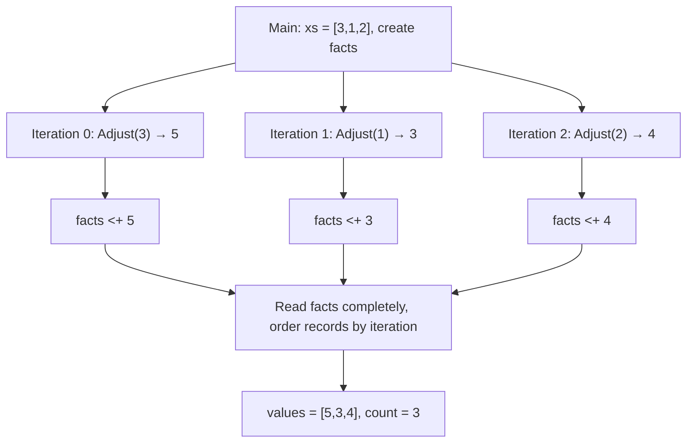

# LIP 1.0

[English](README.en.md) | [简体中文](README.md)

Released version: **1.0**. The complete language design is the [1.2 draft specification](spec/LIP-1.2-SPEC.en.md). The compiler retains the [1.1 specification](spec/LIP-1.1-SPEC.en.md) as its implementation baseline; new 1.2 requirements are not yet implemented and accepted. Historical specifications remain, and the release version is unchanged.

**Compute with values. Organize work as a graph. Build results from facts.**

LIP is a small language for composable computation, parallel analysis, and tool collaboration. Pure functions compute values, Flows organize dependent work, Claims collect facts with provenance, and effect / perform connects external capabilities. Together they describe the whole journey from input to result: what can run concurrently, when a result is complete, and how external actions take place.

The focus is a solid computational core. Math, files, networking, databases, and models come through the **Go / Python ecosystems**. Interactive exploration and generated Go share the same value, dependency, identity, and call rules. LIP fits programs that break down tasks, collect evidence, call tools, and produce an explicit conclusion.

[Language specification](spec/LIP-1.2-SPEC.en.md) · [Example tutorial](examples/README.en.md) · [Implementation and validation](IMPLEMENTATION.en.md)

The 1.2 specification independently defines the complete language, integrating information preservation through encapsulation, interface contracts, diagnostics, and adapter requirements without depending on historical specifications. Examples and limits below describe the current implementation; see the [implementation guide](IMPLEMENTATION.en.md) for the gap between requirements and verified capabilities.

Practical checks cover a CRUD website, SQLite queries, pandas ETL, scikit-learn regression/classification, NumPy linear algebra, and SciPy integration/optimization. The [linear model example](examples/advanced/27_linear_model.lip) demonstrates training, prediction, and error measurement with the pure core. Websites use explicit Host contracts for storage and templates; scientific libraries use the Go/Python bridge in scripts and the REPL. See the implementation guide for tested paths and current limits.

The 1.1 working tree supports explicit purity promises and `nan`, `inf`, and `-inf`:

```lip
import python "math" as py
fn outer(x:number)->number {
    inner = fn(y:number)->number @{ py.sqrt(y) }
    if x >= 0 { inner(x) } else { nan }
}
flow Main()->string { return str([outer(9), outer(-1)]) }
```

Here only `inner` directly calls native code, so `outer` needs no `@`. The marker is an author promise; the compiler does not prove Python/Go purity. Authorization, resource admission, cancellation, and journaling remain enforced. `nan != nan` is true. Negative infinity is below every finite number, which is below positive infinity. REPL/`str` display `nan`, `inf`, and `-inf`; ordinary JSON rejects these nonfinite numbers. Use `-data-encoding c-hex` for lossless CLI/generated input/output. Each input argument is a JSON string containing its canonical hex bytes; an example NaN named input is `-input '{"x":"037ff8000000000000"}'`.

## Suitable workflows and composition boundaries

LIP fits **tool workflows with an explicit completion condition that combine results from several sources and explain the basis for a decision**. A typical structure is concurrent reads or checks → complete Claim collection → a pure decision → conditional external actions.

| Scenario | LIP's role | Existing examples or checks |
|---|---|---|
| Multiple-source checks and evidence reports | Child Flows collect results, Claims retain contribution provenance, and pure functions identify missing, conflicting, or unsatisfactory evidence | [Evidence collection](examples/evidence.lip), `CoreCompositionConformance` |
| Evaluation, batch quality checks, and publication decisions | Run checks concurrently, wait for all results, decide whether they pass, and explicitly choose whether to save or publish | `EvidenceDecisionComposition` checks complete evidence, duplicate values, withheld publication, and error boundaries |
| Staged data processing | Go/Python libraries handle queries and computation; LIP connects dependencies, collects results, and orders writes | [Concurrent reads and ordered writes](examples/ecosystem/19_parallel_read_write.lip), SQLite/pandas application checks |
| Tool collaboration with bounded rounds | Carry loops express “think—call a tool—observe—decide again”; child Flows reuse the steps | [Recorded iteration](examples/ecosystem/20_recorded_iteration.lip), [refine](examples/refine.lip) |

Composition retains four roles: pure `fn` processes immutable values and complete snapshots; `flow` reuses multiple steps with external actions; Claims collect contributions; the Host supplies external capabilities with explicit contracts. A child Flow may return functions, requests, and other ordinary values; its parent may append the Data portion to its Claim; an active Claim is not passed as a shared mutable object. Flow targets are static. Use `for` or comprehensions for repeated Flow calls, and pure callbacks for `map`/`fold`. Claim provenance identifies the work that contributed a fact; business Data must still carry document addresses, checker versions, and evidence content.

Concurrent calls require contracts explicitly declaring Concurrent ReadOnly; generic Go/Python bridge operations remain Unknown. Pure functions can wrap single-step requests: known functions, simple aliases, direct anonymous functions, and imported functions preserve return-operation summaries through multiple calls and recursion. Each `perform` checks all candidate operation contracts for parallel eligibility. Container projections, dynamic calls, and carry results remain Unknown. Business `{ok:false}` values are ordinary data; subsequent actions need explicit `if`/`match` gates.

These workflows operate on complete work within one run. The Host manages long-lived events and starts runs; its contracts supply transactions, cross-request idempotency, and persistent state. Crash recovery is currently unavailable, and complete Claim reads do not return early when a threshold is reached. Large numerical computations stay in native libraries, avoiding a language crossing for each element. See the [implementation guide](IMPLEMENTATION.en.md) for composition evidence and actual limits.

## One program, the whole model

This is the core of [26_flows.lip](examples/advanced/26_flows.lip):

```lip
export OFFSET:number = 2
fn add(value:number, delta:number)->number { value + delta }

export flow Adjust(value:number)->number {
    return value |> add(delta=OFFSET)
}

flow Main(xs:list)->object {
    facts = claim()
    for x in xs parallel {
        result = x |> Adjust
        facts <+ result
    }
    return {values:[row.value for row in facts], count:facts |> len}
}
```

```sh
make build
./lipc run -parallel 4 -input '{"xs":[3,1,2]}' examples/advanced/26_flows.lip
# {"count":3,"values":[5,3,4]}
```

This program adds 2 to each input, allows the iterations to run concurrently, and collects results in input order. Its four declarations have distinct roles:

| Declaration | Role in the program | Accessible from other LIP modules? |
|---|---|---|
| `OFFSET` | Immutable module-level static data with value `2`; `number` is its type annotation | Yes, through `export` |
| `add` | A pure function computing the sum of two numbers | No, private by default |
| `Adjust` | A reusable Flow template using `add` and `OFFSET` | Yes, through `export` |
| `Main` | A Flow template that creates a Claim, expands the loop, and collects results | No; root `Main` is the default entry |

### How `OFFSET` connects modules and computation

Each `.lip` file is a module. Uppercase `OFFSET` is a naming convention; its value is fixed in the code and included in the build snapshot. `export` controls visibility outside the module; root `Main` is the default entry, and `-entry` can select another Flow.

Another file at the project root can use `import lip "./examples/advanced/26_flows.lip" as adjust`, then read `adjust.OFFSET` or call `x |> adjust.Adjust`. The importer chooses the namespace alias `adjust`. The imported `Adjust` always uses `OFFSET` and the private function `add` from its **defining module**. Local values with the same names in the caller do not change its computation. Removing `export` from `OFFSET` would still let `Adjust` use it within this module; external reads of `adjust.OFFSET` would be rejected. See [Child Flows, pipelines, and static modules](#child-flows-pipelines-and-static-modules) for the complete two-file example.

### From declarations to a running result

At build time, the tool freezes the source and imported dependencies, then collects and checks static data, functions, and Flow declarations. Imports establish module relationships; the bodies of `Main` and `Adjust`, including `claim()`, execute when called.

This run establishes the following work and dependencies:

1. Root `Main` is selected by default, and the JSON input binds `[3,1,2]` to `xs`. After input validation, a run is created. The `Main` instance creates **one `facts` Claim shared by all three iterations**.
2. The `for` source `xs` is evaluated once, and three iterations expand in original index order. Each `result = x |> Adjust` instantiates its own `Adjust` subgraph, with separate parameters and structural identity. In the first iteration, the pipeline fixes `3` and passes it to `Adjust(value=3)`. Inside that Flow, `value |> add(delta=OFFSET)` computes `add(value=3, delta=2)`, producing `5`. The pure function `add` computes a value within the current node.
3. Each `facts <+ result` waits for its corresponding subgraph to succeed completely, then submits a record to the shared Claim. The three iterations contribute `5`, `3`, and `4`; their work can interleave.
4. The final `return` reads `facts` completely, waiting for all contribution work. The snapshot orders records by logical position: iterations 0, 1, and 2 in this example. `row.value` extracts each record's value, and `len` counts the records. Once the entire entry graph succeeds, the Host receives `{"count":3,"values":[5,3,4]}`.

This diagram shows the example's value dependencies; each `Adjust` box contains its own subgraph:



Thus `[5,3,4]` preserves input position; neither numeric order nor completion timing changes that order. `|>` evaluates its left side once and completes each stage before entering the next. Pure function stages compute within a node; Flow stages instantiate subgraphs.

`-parallel 4` allows at most four active leaf evaluations across the entire run. Parent and child graphs share one scheduler and budget. Containers waiting for children yield their worker slots so the scheduler can execute child nodes. Set the limit to `1`, and the same program still completes with the same result.

`-parallel N` accepts any positive Go `int`; it does not preallocate N workers or N event slots. Zero uses one in ordinary runs; negative values are rejected. The REPL defaults to four and `:run` inherits its selected limit unless overridden. Eligible work starts on demand, subject to shared resource permits, deadlines, and graph/instruction budgets. A larger limit increases possible overlap, not CPU cores or provider capacity; generic native operations retain their conservative Unknown contract.

Completed branch scopes, loop iterations, and child Flows release local graph payloads before the whole run ends. A pipeline transfers its immutable ordinary result to the caller while child-local scratch data becomes eligible for Go GC. Shared results, closure captures, Claims, journal records, and REPL bindings remain alive while needed. This is scope cleanup, not exact last-use analysis for every binding or constant-memory execution: graph history and journals still grow with work.

## What makes LIP distinctive

### Values and work each have a clear expression

A `fn` is a pure function capturing immutable values, suitable for transformations, validation, recursion, and reduction. A `flow` is a reusable graph template for dependencies, branches, loops, and external calls. Bindings connect results. A successful child Flow means its entire selected subgraph has completed, including work beyond the return expression. Receiving the result also establishes that the stage has finished.


A `fn` may also emit diagnostics while computing:

```lip
fn doubled(x:number)->number {
    log("debug", {input:x})
    x * 2
}
flow Main()->number { return doubled(3) }
```

The result is still `6`. `print(value)`, `log(level, value)`, and `telemetry(name, fields)` all return `null`. They only send diagnostics; disabled delivery, full buffers, and receiver faults cannot change the computation. The CLI uses stderr and keeps results on stdout. `-trace=false` disables delivery while still evaluating and checking arguments. Independent parallel nodes have no fixed log order. See [29_diagnostics](examples/advanced/29_diagnostics.lip) for a complete small example. Acknowledged delivery, readable logs, and business state changes still use `effect/perform`; native operations named `print/log` receive no exemption.

Pure functions support proper tail calls, including direct, mutual, and indirect recursion. Flows repeat work with explicit loops. Local expressions and arguments evaluate from left to right; independent graph nodes follow dependencies and operation contracts. Program structure explains both sequence and concurrency.

The runtime defaults to **10,000 simultaneously active non-tail function calls per leaf evaluation**. `lipc run`, `lipc repl`, `lipc serve`, and generated executables accept `-frames N` to change this budget; `0` selects the default and negative values are rejected. The Go API uses `Options.MaxFrames`. Tail calls reuse frames, so this is not a limit on total recursive calls; instruction/time budgets still apply. Exhaustion returns `E-BUDGET` with the source position and limit, without publishing a successful result. The REPL keeps previous successful bindings and accepts the next cell; `:run` inherits the REPL frame budget unless overridden.

Resource failure does not automatically return `null`, `0`, or an empty container: these could violate the return type or falsely report a completed calculation. An application needing a fallback should define its error response at the Host boundary. Larger frame budgets need sufficient memory; the runtime does not infer available RAM or promise recovery from an operating-system out-of-memory kill.

### Claim gives parallel collection a completion boundary, provenance, and order

`claim()` creates an append-only collection of facts; `<+` submits contributions with structural identities. An identical contribution under the same identity can be delivered again. Equal values under different identities remain distinct facts. A complete read waits for all producers, then returns records containing values and source positions.

Counts, missing evidence, rankings, scores, and final reports are ordinary pure projections. Fact collection and business decisions can be reused independently, while each result remains traceable to its contributing work. Use a live snapshot for a single immediate observation; read the Claim directly for a complete conclusion.

### Every external action follows one protocol

`effect` fixes an operation and its arguments into a request value. `perform` handles admission, invocation, and recording. Host contracts declare schemas, versions, permissions, effects, concurrency, and resource requirements. The runtime uses them to overlap eligible reads and preserve ordering around writes.

A minimal program, run with `-host demo`, returns `"HELLO"`:

```lip
import go "strings" as text
fn upper_request(name:string)->effect { effect text.ToUpper(name) }
flow Main()->string {
    request = upper_request("hello")
    result = perform request
    return result
}
```

`upper_request` constructs a reusable request value; `perform` calls the library. The operation contract determines the result type: string, number, list, object, or other Data. Results do not require a common wrapper object. [Requests and execution](examples/ecosystem/18_proposals.lip) also demonstrates passing a request through a fn parameter, chaining requests, and receiving both string and number results.

A request does not cache its result: performing the same request at two `perform` sites means two calls. Reusing the bound `result` does not call again. A request is an ordinary value but is not Data; Data recursively excludes fn and effect values.

| Where can a request value go? | Current rule |
|---|---|
| Local bindings, list/object, closures, fn parameters and results | Allowed; storing and passing never execute it |
| Same-run Flow parameters and results | Functions, effects, and nested containers are allowed |
| Program entry/exit protocol | Data required; functions and effects are excluded |
| Host parameters and results, Claim contributions, JSON | Data required; effect values are excluded |

With `-host demo`, this still returns `"HELLO"`. Prepare returns a request; Execute receives and performs it. Nested arguments finish in order:

```lip
import go "strings" as text
flow Prepare(name:string)->effect { return effect text.ToUpper(name) }
flow Execute(request:effect)->any { return perform request }
flow Main()->string { return Execute(Prepare("hello")) }
```

Functions travel the same way: the [cross-Flow closure example](examples/advanced/28_flow_values.lip) returns a captured function and passes it to another Flow. Flow definitions themselves cannot be assigned or passed.

The two arguments in `Combine(Read(1), Read(2))` finish sequentially. To let eligible independent reads overlap, bind `a = Read(1)` and `b = Read(2)` separately before calling `Combine(a, b)`. Nesting is shorter but does not automatically add concurrency.

Pure wrappers preserve known operation summaries. [Parallel reads with ordered writes](examples/ecosystem/19_parallel_read_write.lip) demonstrates parallel `perform upper_request(name)` calls. Parallel execution requires an operation explicitly registered as Concurrent ReadOnly; wrapping an Unknown bridge operation cannot upgrade it. Requests passed through an unknown fn parameter or retrieved from a container can still execute sequentially, but these paths cannot establish parallel safety.

Projects can register their own operations. If the application Host registers `ai.generate(prompt:string, policy:object)->object`, a request can carry project options like this:

```lip
import host "project/ai" as ai
fn answer_request(prompt:string, policy:object)->effect {
    effect ai.generate(prompt, policy=policy)
}
flow Main()->object {
    request = answer_request("Explain Claim briefly", {
        max_output_tokens: 128, max_cost_microusd: 1000, timeout_ms: 2000
    })
    return perform request
}
```

This is an application integration sketch requiring a registered Host; `-host demo` does not supply this operation. `policy` is an ordinary Data parameter whose field names, units, and behavior belong to the project. This example uses integer micro-US dollars: 1000 microdollars equals USD 0.001. The Host/adapter must enforce token, money, and time limits; accepting fields alone does not enforce them. Calls such as `numpy.sqrt` that need no options stay unchanged.

Contract `Capabilities` declare required permissions, the Host grants them, and `Authorize` checks finer scopes; requests cannot grant themselves access. `Resources` are reusable concurrency permits, not cumulative spending. Estimates, hard limits, and actual usage need separate treatment. The Host can record actual usage in `Response.Receipt` while returning business data through `Response.Value`; include usage in the result schema when LIP code needs it. There is currently no built-in shared token/money ledger, and timeout cancellation does not guarantee reversal of external actions already taken.

Direct Go/Python library calls lower to this protocol too. Interactive convenience, explicit operation contracts, and generated programs share the same external call path. Argument and authorization checks precede actual operations.

### Dynamic work has stable structural identity

Loop iterations, child Flows, contributions, and calls derive identities from source positions and dynamic paths. These identities connect diagnostics, Claim provenance, and call records without numbering work by arrival or completion. Modules are frozen into one source snapshot at build time; source contents, versions, and dependency resolution determine its build identity.

Under the specification's conditions—fixed inputs and external responses, fair and finite termination, no live snapshot, and no cancellation or budget interference—legal schedules produce the same successful result or primary error. Claim order and structural identities make those results inspectable. See [specification §13](spec/LIP-1.2-SPEC.en.md#13-determinism-and-guarantee-boundaries) for the complete conditions.

### One program, from exploration to a Go executable

The REPL, 38 bundled lessons, file execution, and Go generation use one core. The generator compiles expressions into dedicated Go evaluation functions and includes the scheduler and Host runtime. Generated programs execute those functions directly, without parsing LIP source again or reading the source directory.

These mechanisms are implemented in an executable compiler and runtime. Tests build and run generated programs, comparing outputs, errors, identities, and call boundaries. Composition tests combine modules, closures, loops, child graphs, and pipelines at worker limits 1, 2, 4, 7, 1238, and 73295. [Implementation and validation](IMPLEMENTATION.en.md) maps specification sections to concrete tests.

## Getting started

Use **Go 1.25 or newer**. Basic Python examples use the Python 3 standard library; scientific examples require the respective packages in the active Python environment. From the project root containing `go.mod`:

```sh
make build
./lipc run examples/basics/01_hello.lip
# "Hello, LIP!"
./lipc run -parallel 4 examples/evidence.lip
# {"missing":["b","c"]}
./lipc repl
./lipc learn -lesson flows
```

Install the command to use the bundled runtime and lessons from other directories:

```sh
go install ./cmd/lipc
export PATH="$(go env GOPATH)/bin:$PATH"  # Default location when GOBIN is empty.
lipc help
lipc learn -list
```

If GOBIN is set, add that directory to PATH. A custom location can be selected with `GOBIN="$HOME/.local/bin" go install ./cmd/lipc`. Save PATH in your shell configuration; on Windows, configure user PATH and use `lipc.exe`. The current Go module name is `lip`; these installation commands use local source.

## Language core and program structure

Bindings are immutable; inner scopes can shadow ordinary names. Values include null, bool, finite binary64 numbers, signed infinities, and canonical `nan`, UTF-8 strings, lists, objects, pure functions, and requests. **Data** recursively excludes functions and requests and is the boundary format for entry protocols, Hosts, and Claims; same-run Flows can pass all ordinary values. An `any` annotation still requires the type and Data checks of its eventual use.

| Work to express | Syntax |
|---|---|
| Pure transformation | `fn twice(x:number)->number { x * 2 }` |
| Conditions and dispatch | `if ... { ... } else { ... }`, `match` |
| List transformation and reduction | Comprehensions, `map`, `fold` |
| Carry a result between iterations | `for x in xs with total=0 { next total+x }` |
| Independent work and fact collection | `for x in xs parallel { facts <+ x*x }` |
| Structured stages | `x |> Adjust |> Finish` |
| External request and execution | `request=effect op(args)`, `perform request` |

Lists and objects can grow round by round. `next` passes the whole new state to the next iteration, and the result can seed another batch:

```lip
fn AddTools(names:list, initial:object)->object {
    for name in names with s = initial {
        tool = {name:name}
        next {
            tools: concat(s.tools, [tool]),
            by_name: put(s.by_name, name, tool)
        }
    }
}
flow Main()->object {
    first = AddTools(["read"], {tools:[], by_name:{}})
    return AddTools(["write"], first)
}
```

The result has two tools and a by_name index; first still has one tool. `put` replaces a field with the same key, while `concat` retains duplicate list entries. Empty input returns the initial state. A Flow can also perform an external action before carrying its result into the next round; see the [carry example](examples/structures/12_carry.lip). Prefer a comprehension when only transforming input items into a list; repeated `concat` has no constant-time append guarantee and may copy quadratically for large lists.

Arithmetic includes `+ - * / // % ** */`. Exponentiation `**` associates right: `2 ** 3 ** 2` is 512, `-3 ** 2` is -9, and `2 ** -3` is 0.125. `8 */ 2` is the logarithm of 8 with base 2, yielding 3. Powers and logarithms use fixed binary64 approximation algorithms; finite-operand domain errors and overflow raise `E-NUMBER`; existing NaN/infinite operands follow specification §3.3. See the [tutorial](examples/README.en.md) for numerical, string, and control-structure examples.

### Entry points and successful results

Files can declare static literal Data, pure functions, and multiple Flows. Without `-entry`, select root `Main` first; otherwise select the sole root Flow, or require an explicit choice. Names are case-sensitive, imported `Main` Flows do not participate, and explicit `-entry Name` overrides the default. All declarations in the source closure are checked, including unselected ones.

```lip
BASE:number = 2
fn add_base(x:number)->number { x + BASE }
flow Main(x:number)->number { return add_base(x) }
flow Empty()->void {}
```

Save as `program.lip`, then run:

```sh
./lipc run -input '{"x":3}' program.lip
# 5
./lipc run -entry-input '{"positional":[3],"named":{}}' -entry-output program.lip
# {"kind":"value","value":5}
./lipc run -entry Empty -entry-output program.lip
# {"kind":"void"}
```

`-input` takes a JSON object of named arguments; `-entry-input` takes the full EntryInput. They are mutually exclusive. Validation happens before allocating a run_id, journal, or graph; invalid inputs raise `E-SCHEMA`. Default output is JSON. `-entry-output` preserves the success envelope, distinguishing void from a returned null, `{"kind":"value","value":null}`. Successful output waits for the entire graph. Business logging and file writes use external operations; one-way debugging may use print/log/telemetry as described above; the teaching Host writes console output to stderr, keeping stdout for results.

### Child Flows, pipelines, and static modules

Child Flows receive context through parameters; bindings and Claims belong to individual instances. Parameters/results may carry functions, effects, and nested containers. Arguments fully evaluate in source order before the child starts; nested calls are allowed. Flow targets are static; recursive Flow call graphs are rejected at compile time.

Pipeline stages are named functions, Flows, exported module functions/Flows, or core pure functions. Function values and native library functions use ordinary calls. `|>` binds less tightly than `||`; compare stage results with `(x |> F) == y`. Business values such as `{ok:false}` are ordinary Data; use `if` or `match` to decide what follows.

Modules publish declarations with `export` and use their own static data, functions, and imports. Save this `reuse.lip` at the project root to reuse the opening example:

```lip
import lip "./examples/advanced/26_flows.lip" as adjust
flow Main(xs:list)->list {
    return [x |> adjust.Adjust for x in xs]
}
```

```sh
./lipc run -input '{"xs":[3,1,2]}' reuse.lip
# [5,3,4]
```

`run`, `emit-go`, `build`, and `serve` freeze the complete dependency closure. `-project` selects the project root, defaulting to the entry file's directory. Symlinks below the root, escaping paths, and duplicate physical files are rejected. Builds allow up to 4,096 sources and 64 MiB total. LIP module imports resolve declarations; rebuild after source changes.

## Connecting Go / Python

CLI file execution, builds, and the REPL enable the generic library bridge by default. Call libraries in the current Go/Python environment, or register Host contracts with explicit schemas, effects, and concurrency guarantees.

```text
In [1]: import go "strings"
In [2]: strings.ToUpper("hello, lip")
"HELLO, LIP"
In [3]: import go "bytes"
In [4]: buffer = bytes.NewBufferString("hello")
<go *bytes.Buffer>
In [5]: buffer.WriteString("!")
1
In [6]: buffer.String()
"hello!"
In [7]: import python "math"
In [8]: math.sqrt(9)
3
```

Direct calls, methods, and attribute reads lower to ordinary `perform effect` before checking. Constructing an `effect` only saves the request. Generic operations are Unknown and follow write restrictions. Explicit registrations take precedence; `parallel` admits only operations declared Concurrent ReadOnly.

Use explicit requests when a native object arrives through a Flow parameter:

```lip
flow Predict(model:object,rows:list)->list {
    return native_data(perform effect model.predict(rows))
}
```

`effect receiver.method(...)` uses the receiver's lexical binding, including saved REPL values and parameters in imported LIP modules. Nested members such as `effect library.linalg.solve(matrix,rhs)` also work. Constructing the request performs no member lookup or native call; `perform` applies the normal authorization and resource checks. Deleting or rebinding the public name preserves the receiver already captured by a saved request.

Closures may capture resource references and requests and pass them across child Flows without extending resource lifetimes or changing permissions. Native actions still use `perform`. A fn directly invoking native computation requires an `@{...}` body, explicitly promising purity.

Pure functions can also construct requests returning native objects. With the default library bridge, this program returns `5`:

```lip
import go "bytes"
fn buffer_request(text:string)->effect { effect bytes.NewBufferString(text) }
flow Main()->number {
    buffer = perform buffer_request("hello")
    return buffer.Len()
}
```

Statically known request builders preserve native result information so methods can follow `perform`, including through wrapper chains, modules, and pipelines. This information supports library syntax conversion separately from Ops and parallel eligibility; generic operations remain Unknown. When static provenance is insufficient, use explicit `effect receiver.method(...)`.

The [teaching Host](script/adapters.go) demonstrates parallel reads and sequential writes through explicit contracts:

```sh
./lipc run -host demo -parallel 4 examples/ecosystem/19_parallel_read_write.lip
# ["ADA","LIN","SAM"]; console logs go to stderr.
./lipc run -host demo examples/ecosystem/17_go_python.lip
# {"digest":"a615eeaee21de5179de080de8c3052c8da901138406ba71c38c032845f7d54f4","mean":2}
```

Multi-round tool programs progress through “think → call → observe → decide again.” [recorded_iteration](examples/ecosystem/20_recorded_iteration.lip) passes recorded responses into the next iteration; [evidence](examples/evidence.lip) collects complete evidence; [refine](examples/refine.lip) carries values through iterative improvement. Models and business tools can use the same Host contracts. The Host receives ongoing events and starts independent runs for them.

The [local Ollama chat example](examples/tmp_ollama_chat.lip) keeps streaming chat, dispatch and argument validation for seven tools, SQLite calculation records, and active reminders in one `.lip` file. Model requests use the official Python `ollama` client; storage and timers call standard libraries directly. See the [example instructions](examples/README.en.md#local-ollama-chat-saved-calculations-and-reminders) for setup and commands. The database defaults to `.ollama_chat/state.sqlite3` under the current working directory; set `LIP_CHAT_DB` to choose a path.

It also uses 1.1 ordinary-value passing in practice: `RunAgent` accepts a pure request builder, `StreamReply` accepts and performs its effect, and `Query`/`Write` accept SQLite requests and handle cursor cleanup. Model configuration lives at startup; a replacement request builder must still provide the same streaming response interface.

### Third-party libraries and runtime environment

Go imports use full, case-sensitive package paths. The working directory's Go module resolves dependencies:

| Library | Import |
|---|---|
| Gonum matrices | `import go "gonum.org/v1/gonum/mat" as mat` |
| Gorgonia | `import go "gorgonia.org/gorgonia" as gorgonia` |
| Gin | `import go "github.com/gin-gonic/gin" as gin` |
| Viper | `import go "github.com/spf13/viper" as viper` |

Configure your project in the terminal, then start the installed lipc:

```sh
mkdir analysis
cd analysis
go mod init example.org/analysis
go get gonum.org/v1/gonum/mat
lipc repl
```

```text
In [1]: import go "gonum.org/v1/gonum/mat" as mat
In [2]: m = mat.NewDense(2,2,[1,2,3,4])
<go *mat.Dense>
In [3]: m.At(1,0)
3
```

With an existing `go.mod`, configure dependencies directly. Imports and completion neither execute library initialization nor install dependencies. Go export discovery uses the toolchain; Python loads modules on the first actual operation. The automatic Go development bridge used by the REPL and interpreted files requires the Go toolchain, CGO, and Go plugin support (Linux, macOS, FreeBSD). Generated executables statically link automatic package exports and generic instances inferred at build time; their calls need neither the Go toolchain nor plugin loading. When a generic call has argument types that remain unknown at build time, supply concrete instances through trusted Host registration source. Interactive generic calls can infer instances from actual values.

Python uses a persistent worker and a separate protocol channel, retaining modules and objects in the current environment:

```text
In [1]: import python "numpy" as np
In [2]: import python "scipy" as sp
In [3]: a = np.array([1,2,3], dtype=np.int64)
<python numpy.ndarray>
In [4]: a.reshape(3,1).tolist()
[[1],[2],[3]]
In [5]: sp.linalg.norm(a)
3.7416573867739413
```

Module attributes, submodules, classes, methods, named arguments, and native function references use the same bridge. `help()`, `help(module)`, `help(module.member)`, and `help(value)` provide interactive guidance, library documentation, and Go export signatures. `help("math.sqrt")` queries Python documentation. Without `as`, the final path component becomes the name. Go's string package is `strings`.

### Values and resources

| Value or operation | Bridge behavior |
|---|---|
| null, bool, number (including nan, inf, and -inf), string | Ordinary Data; native integers must convert exactly within the supported range |
| LIP list / object | Convert to the Go target type or Python list / dict |
| Ordinary Python list / tuple / string-keyed dict | Language containers, potentially containing resource references |
| Go containers, structs, pointers, functions; Python arrays, DataFrames, bytes, etc. | Resource references scoped to the Host |
| `native_data(value)` | An acyclic Data snapshot through perform; supports Go containers/exported fields and Python containers/`tolist()` |
| `native_release(value)` | Release that reference; close files and similar resources with their own methods |

Go numbers are checked against target integer ranges; string-to-`[]byte` conversion uses UTF-8. Safe integral Python arguments become int; other numbers become float. Take snapshots or encode bytes to cross Go/Python runtimes. Cyclic objects cannot become Data; NaN and signed infinities are supported, with NaN normalization. A trailing error among multiple Go results is the failure channel; a sole error result remains a native resource, with nil as null. Native function references can be passed within a runtime; language pure functions need an application adapter to serve as native callbacks. The `native_data` / `native_release` helpers follow lexical name resolution; local declarations take precedence.

The Host owns workers, objects, and permissions. Native references record scope, owner, and generation. File-run handles expire at run completion; failed cells release newly created handles, while successful cells retain handles reachable through saved values, closures, proposals, or their result. Saved session handles remain valid until explicit release, reset, or close. An invalid or foreign handle raises `E-RESOURCE`. Closing or resetting invalidates existing references. Embedding Hosts can acquire run leases with `Host.BeginRun` and release them with `RunLease.End`; cleanup follows settlement of started operations on success, failure, cancellation, and budget termination. `Report.CleanupErrors` preserves cleanup faults separately from node errors. Cancellation or lost communication never automatically repeats an external action. Native libraries have their process or worker's OS permissions; applications supply deployment isolation when needed.

## Interactive computation and learning

```sh
./lipc repl
./lipc repl -host demo
./lipc learn
./lipc learn -list
./lipc learn -lesson modules
```

Normal CLI prompts, interactive help, lessons, and example comments use English. Documentation is maintained in linked Chinese and English editions.

The REPL retains values, fn/Flow declarations, and closures from successful cells. Historical actions run once. Failed cells commit no new bindings; external actions already performed remain. Each cell is an independent run. Named functions can serve as pipeline stages across cells:

```text
In [1]: x = 6
6
In [2]: fn twice(n:number)->number { n * 2 }
In [3]: x |> twice
12
```

Flow declarations, static Data, exports, LIP imports, Claims, and the script statement syntax also work in the REPL. Declaring a Flow checks and saves it; invoke it explicitly with arguments:

```text
In [4]: import python "math" as math
In [5]: flow sqr(x:number)->number { return perform effect math.sqrt(x) }
In [6]: 12 |> sqr
3.4641016151377544
In [7]: sqr(12)
3.4641016151377544
```

`:del name` or `:del var1,var2` removes names from the session namespace, whatever they refer to. The names disappear from lookup, `:vars`, and completion and can be rebound to any allowed value or declaration. The whole deletion is validated first: malformed or missing names leave all bindings unchanged. Existing closures and Flows retain their original captured values, callees, and import meanings when a name is reused. Unreachable saved values/Flows are released; still-referenced data remains alive. Deletion does not repeat actions, unload cached modules, close native resources, or erase history. Use the resource's explicit close/release operation for its lifecycle, or `:reset` to clear the whole session.

```text
:del x,twice
x = "a reused name"
fn twice(n:number)->number { n+n }
```

For a whole script, forward references between declarations, or a top-level Claim with its producers and reads, enter `:begin`, paste the source, then enter `:end`. Bracketed terminal paste also submits several lines as one cell. An `if` statement without `else` waits for a possible `else` on the following line; a blank line or another statement submits it. Statement forms support void Flow calls; value forms display their result. Active Claims belong to one cell or Flow invocation; the session retains only their completed Data snapshots, so put joins and reads in the same cell or Flow.

`import lip "./lib/pricing.lip" as pricing` resolves within `lipc repl -project DIR` (default: the current directory). Imports freeze the complete source closure before execution and keep it until `:reset`; existing closures keep their defining environment. Completion does not run imported code. To run an independent file with explicit entry/input options, use `:run`:

```text
:run -input '{"xs":[3,1,2]}' examples/advanced/26_flows.lip
:run -entry Add -entry-input '{"positional":[3],"named":{}}' -entry-output "path with spaces/program.lip"
```

`:run` accepts normal file options for entry, project root, and inputs, inheriting the session Host by default. File runs are independent of REPL bindings. Single/double quotes group paths or JSON; command arguments are parsed literally. `:vars` shows values, `:history` shows inputs, `:reset` clears the session, `:cancel` discards a draft, and `:quit` exits. Piped input automatically hides prompts:

```sh
printf 'x=6\nx*2\n:quit\n' | ./lipc repl
```

The REPL and learn share an editor:

| Keys | Action |
|---|---|
| ← / →, Ctrl-B / F; Home / End; Ctrl-A / E | Move; reach current line boundaries; reach whole-input boundaries |
| Alt-B / F, Ctrl-← / → | Move by word |
| Backspace / Delete, Ctrl-D | Delete; Ctrl-D exits on empty input |
| Ctrl-U / K / W, Alt-D; Ctrl-Y | Cut to start/end, previous/next word; paste back |
| Ctrl-_ (often Ctrl-/); Ctrl-T | Undo; transpose nearby characters |
| ↑ / ↓; Ctrl-P / N; Ctrl-R | Browse history on one line, move vertically in multiline input; browse history anytime; search, Ctrl-G cancels |
| Alt-Enter or Ctrl-J; Tab | Insert an indented line; complete names, or indent with no prefix |
| Ctrl-L; Ctrl-C | Clear screen; discard input and draft |

Open brackets, braces, and triple-quoted strings support multiline input; otherwise use a trailing `\`. The editor supports bracketed paste, Chinese text, and common combining characters. Raw mode applies only during editing and is restored before provider calls; pipes use plain text. Terminal interfaces support Linux, macOS/BSD, and VT-enabled Windows consoles; current platform validation is Linux.

Lists support negative scalar indices, index lists, and Python-style slices. String indices and slices count Unicode scalars:

```text
a = range(100)
a[-1]             # 99
a[range(4)]       # [0,1,2,3]
a[[3,-1,3]]       # [3,99,3]
a[2:10:2]         # [2,4,6,8]
a[::-1]           # [99,98,...,0]
"a𐀀b"[::-1]     # "b𐀀a"
slice(a,null,null,-1)  # Same as a[::-1]
```

Scalar/gather indices reject out-of-bounds access. Slices clip bounds, exclude stop, and reject zero step.
Omitted bounds and null are equivalent; with negative step, omitted stop differs from explicit -1.
Index lists preserve order and duplicates. Try `./lipc learn -lesson slicing` or `help(slice)` in the REPL.

The 38 lessons include 76 runnable examples. Start by reading one list item, one object field, or calling one function, then gradually combine Flows, Claims, and external requests. Combined slices, powers, and logarithms come last as extra practice. Each lesson shows an example, concrete input, and expected result. Usually, fill only `__ANSWER__` and press Enter; there is no need to rewrite the program. Every lesson except the first checks multiple inputs.

| Learning command | Use |
|---|---|
| `:examples`, `:tests` | Run two small examples; show all acceptance inputs and expected results |
| `:hint` | Reveal an idea, a worked example, then one possible answer |
| `:draft`, `:retry` | Review current/last code; load the last answer for editing in a terminal, or type its replacement in a pipe |
| `:demo` | Run a complete reference program without marking completion or replacing your draft |
| `:edit`, `:submit`, `:cancel` | Enter a whole program, check it, or return to the blank; complete programs can also be pasted directly in a terminal |
| `:next`, `:prev`, `:lesson ID`, `:status` | Move freely, jump to a lesson, or review progress; passing is optional before continuing |

Errors include the diagnostic, relevant source line, and a suggestion. Answers stay in the current process by lesson, so return later and use `:retry` to revise them. Tab completes parameters and function names from the template. Alt-Enter adds a line, arrows move through multiline text, and failed complete programs can be loaded for editing too. Module dependencies are bundled for learning away from the repository. External-call lessons use the teaching Host automatically and show the `-host demo` option needed for file execution. An `else` may start on the next line; for multiline complete programs in pipes, start with `:edit` and finish with `:submit`.

The progress file stores only the current lesson and completion marks, using stable IDs compatible with earlier progress. Drafts stay in memory. Save progress explicitly:

```sh
./lipc learn -progress /path/to/progress.json
```

### Why does fmt.Print show a number?

Go's `fmt.Print`, `fmt.Printf`, and `fmt.Println` return `(bytesWritten, error)`. The Go adapter turns a non-nil trailing error into a LIP error and returns the remaining count. The REPL displays the final expression or binding value, so it displays that count as well:

```text
In [1]: import go "fmt"
In [2]: fmt.Print("hello")
hello5
In [3]: fmt.Println("hello")
hello
6
```

`Print` adds no newline, so its text and the REPL's result appear together. `Println` writes a newline and includes it in its count. This is a UTF-8 **byte count**: two three-byte characters return 6, even though `len` of that string is 2. Binding the result also displays it; a trailing semicolon is padding and does not suppress it. To use printing only for its side effect within a cell, write `for unused in [0] { fmt.Print("hello") }`; the loop has no displayed result, and the call still runs once. Ordinary calls continue to return the byte count for programs that use it.

## Generating Go programs

```sh
./lipc build -o .build/flows examples/advanced/26_flows.lip
./.build/flows -input '{"xs":[3,1,2]}'
# {"count":3,"values":[5,3,4]}

./lipc emit-go -o .build/hello.go examples/basics/01_hello.lip
go build -o .build/hello .build/hello.go
./.build/hello
# "Hello, LIP!"
```

Generated programs fix the entry and source snapshot and accept `-input`, `-entry-input`, `-entry-output`, `-parallel`, `-frames`, `-steps`, and `-elements`. They verify Host contracts at startup. Pure core programs and the Go portion of the teaching Host use only the standard library. Python operations require their runtime environment; Go packages are linked at build time, so deployed calls need no toolchain or plugin support.

Use the Makefile for project-local caches:

```sh
make compile SOURCE=examples/ecosystem/17_go_python.lip HOST=demo OUTPUT=.build/interop
./.build/interop -parallel 4
```

`make compile` also accepts `ENTRY` and `PROJECT`. Adapters and compilation need writable temporary space. `make build/test/race/vet` configure caches under `.build`; direct Go commands can set `GOTMPDIR` / `TMPDIR`. Recreate those directories after `make clean`.

## Websites and HTTP integration

The HTTP Host converts requests to Data and runs a Flow independently for each request. Entries have the form `flow Name(request:object)->object`:

```sh
./lipc serve examples/web/23_home.lip
# http://127.0.0.1:8080/
./lipc serve -route 'POST /api/echo' examples/web/24_echo.lip
curl -H 'Content-Type: application/json' -d '{"name":"Ada"}' http://127.0.0.1:8080/api/echo
```

Requests provide method, path, raw_path, host, params, query, headers, body, and json. Repeated query/header values are preserved, header keys are lowercase, and bodies explicitly use utf-8 or base64. Responses contain status, optionally json or body, and headers with string or string-list values. Triple-quoted strings can contain HTML; use an escaping template library for dynamic content. See [23_home.lip](examples/web/23_home.lip).

Configure multiple routes with `./lipc serve -routes routes.json`. Source paths are relative to the manifest, and each route can select an entry:

```json
[
  {"pattern":"GET /{$}","source":"examples/web/23_home.lip"},
  {"pattern":"POST /api/echo","source":"examples/web/24_echo.lip"},
  {"pattern":"GET /api/hello/{name}","source":"examples/web/25_greeting.lip"}
]
```

Routes use explicit-method ServeMux patterns; compilation and conflict checks happen before listening. HEAD matches only explicit HEAD routes, and a 405 Allow header lists only configured methods. For `/{x}` matching `/a%2Fb`, path is `/a/b`, raw_path is `/a%2Fb`, and params.x is `a/b`. Runs, Claims, records, budgets, and cancellation are isolated per request; responses commit after validation succeeds.

Defaults are 30 seconds, 1 MiB each for request/response bodies, 8 MiB each for canonical Data, and 64 concurrent requests across routes. CLI options are `-timeout`, `-concurrent`, `-body-bytes`, `-response-bytes`, `-parallel`, `-frames`, `-steps`, and `-elements`; zero selects defaults. Embedded configuration also provides `HTTPOptions.MaxDataBytes`.

`serve` uses pure core or explicit teaching contracts with `-host demo`. Embed through `NewHTTPHandler` / `NewHTTPMux` and application authentication middleware. Authorization and operations receive the same context; applications own Hosts and connection pools. `HTTPOptions.OnError` receives server diagnostics while public errors use fixed categories. HTTP uses explicit Host operations; the generic native bridge currently serves files, sessions, and generated programs. See [specification §12.1](spec/LIP-1.2-SPEC.en.md#121-optional-http-host-integration).

## Embedding and build identity

The Go import path is `lip/script`:

| Purpose | API |
|---|---|
| Single-source compilation and entry selection | `Compile`, `CompileWithOptions` |
| Freeze disk modules / use in-memory sources | `LoadSourceSet`, `CompileSourceSet` |
| Strict entry protocol | `DecodeEntryInput`, `Program.RunEntry` |
| Named-input convenience | `Program.Run` |
| Libraries / interactive sessions | `NewNativeHost`, `NewInteractiveSession`, `NewSession` |
| Go generation | `Program.EmitGo`, `GoOptions.HostSource` |

For example, register application Go exports:

```go
host := script.NewNativeHost(script.Host{})
defer host.Close()
host.Native.Go.RegisterPackage("application/text", map[string]any{
    "Upper": strings.ToUpper,
})
// LIP: import go "application/text" as text; text.Upper("hello")
```

Explicit contracts use `Host.Contracts`, with `GoHandler` / `PythonHandler` adapters. `DemoHost` and `DemoHostGoSource` provide matching teaching registrations. Use `GoOptions.HostSource` to supply the same application Host configuration in generated programs.

`Program.BuildInfo()` returns root, entry, revision, source_table, and dependency_lock; `SourceSet.Lock` checks locked resolution. SourceTable sorts by SourceID; StaticSite orders the root first, then other sources by SourceID. `Options.After` accepts node/region/site wire completion constraints, including empty regions and dynamic work not yet expanded.

`Report.EntryOutput` exists only after the entire graph succeeds; `Report.Output` is the default display value. MemoryJournal supports in-process call recording and replay; the optional durable crash-recovery profile remains future work. HTTP provides bounded complete requests and responses; applications organize ongoing subscriptions, WebSocket, SSE, and deployment authentication.

## Development and validation

Maintain paired Chinese/English documentation and use English for code, comments, and user-facing messages. See the [development guide](DEVELOPMENT.en.md).

```sh
make test       # Core, lessons, examples, interaction, actual generated Go programs.
make race       # Race detection on both execution paths.
make vet
make examples   # Inspect example validation results.
make clean      # Remove artifacts and project-local caches.
```

Numerical and encoding checks use fixed specification vectors. Scheduling tests check overlap, prerequisites, Claim completion, and primary errors; Host tests check admission, resources, and replay. Tests verify error locations and zero additional calls as well as successful output. Environment-dependent tests state prerequisites and skips explicitly. See [IMPLEMENTATION.md](IMPLEMENTATION.en.md) for coverage and validation results.

```text
cmd/lipc/  CLI, REPL, bundled lessons, HTTP
script/    Compilation, checking, evaluation, scheduling, Go generation, Host
examples/  Annotated executable programs
tests/     Core rules and interpreter/generated-program agreement
spec/      LIP 1.1 working draft and retained 1.0 contract
```

Core and tooling stay together by responsibility. New library capabilities come through Go/Python and the Host, keeping the language small and complete.
