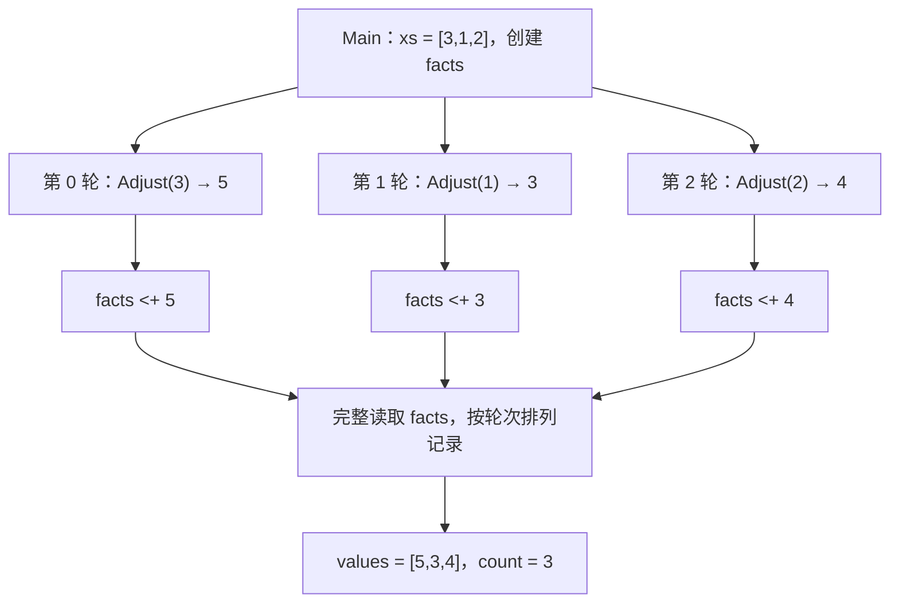

# LIP 1.0

[English](README.en.md) | [简体中文](README.md)

当前版本：**1.0**。

**用值描述计算，用图组织工作，用事实形成结果。**

LIP 是一门面向可组合计算、并行分析与工具协作的小语言。纯函数计算值，Flow 把工作组织成依赖图，Claim 汇聚带来源的事实，effect / perform 连接外部能力。这些机制共同定义从输入到结果的完整过程：哪些工作可以同时进行，何时结果才算完整，外部动作通过什么边界发生。

LIP 的重点是把这套计算核心做扎实。数学、文件、网络、数据库和模型能力接入 **Go / Python 生态**；从交互探索到编译为 Go，沿用同一套值、依赖、身份与调用规则。它适合需要分解任务、收集证据、调用工具并形成明确结论的程序。

[语言规范](spec/LIP-1.0-SPEC.md) · [示例教程](examples/README.md) · [实现与验证](IMPLEMENTATION.md)

实际应用检查覆盖 CRUD 网站、SQLite 查询、pandas ETL、scikit-learn 回归/分类、NumPy 线性代数和 SciPy 积分/优化。[线性模型示例](examples/advanced/27_linear_model.lip) 使用纯核心演示训练、预测与误差计算。网站通过显式 Host 合约接入存储和模板；科学计算库在脚本和 REPL 中通过 Go/Python bridge 使用。已验证的执行路径与当前限制见实现说明。

## 一个程序，看见整个模型

下面是 [26_flows.lip](examples/advanced/26_flows.lip) 的核心内容：

```lip
export OFFSET:number = 2
fn add(value:number, delta:number)->number { value + delta }

export flow Adjust(value:number)->number {
    return value |> add(delta=OFFSET)
}

flow Main(xs:list)->object {
    facts = claim()
    for x in xs parallel {
        result = x |> Adjust
        facts <+ result
    }
    return {values:[row.value for row in facts], count:facts |> len}
}
```

```sh
make build
./lipc run -entry Main -parallel 4 -input '{"xs":[3,1,2]}' examples/advanced/26_flows.lip
# {"count":3,"values":[5,3,4]}
```

这个程序把每个输入加上 2，允许各轮工作并行，再按输入位置汇总。先看它的四个声明：

| 声明 | 在程序中的角色 | 其他 LIP 模块能否访问 |
|---|---|---|
| `OFFSET` | 值为 `2` 的模块级不可变静态数据，`number` 是类型注解 | 能，声明带有 `export` |
| `add` | 计算两数之和的纯函数 | 不能，默认私有 |
| `Adjust` | 使用 `add` 和 `OFFSET` 的可复用 Flow 模板 | 能，声明带有 `export` |
| `Main` | 创建 Claim、展开循环并汇总结果的 Flow 模板 | 不能；本次由 `-entry Main` 选为根入口 |

### `OFFSET` 怎样连接模块与计算

一个 `.lip` 文件就是一个模块。`OFFSET` 的大写只是命名习惯；它是代码中固定的数值，随源码进入构建快照。`export` 控制模块外的可见性，入口选择则由 `-entry` 控制。

项目根目录的另一个文件通过 `import lip "./examples/advanced/26_flows.lip" as adjust` 导入后，可以读取 `adjust.OFFSET`，也可以写 `x |> adjust.Adjust`。`adjust` 是导入者选的命名空间别名。被导入的 `Adjust` 始终使用**定义模块**里的 `OFFSET` 和私有函数 `add`，调用者的同名局部值不会改变它的计算。即使去掉 `OFFSET` 前的 `export`，本模块的 `Adjust` 仍可使用它，外部直接读取 `adjust.OFFSET` 才会被禁止。完整的双文件用法见[子 Flow、管道与静态模块](#子-flow管道与静态模块)。

### 从声明到运行结果

构建时，工具冻结源码与导入依赖，收集并检查静态数据、函数和 Flow 声明。导入只建立模块关系；`Main`、`Adjust` 的 Flow 体及其中的 `claim()` 在相应 Flow 实际调用时才执行。

本次运行依次建立这些工作与依赖：

1. `-entry Main` 选择入口，JSON 输入把 `[3,1,2]` 绑定到 `xs`。输入验证通过后创建本次 run；`Main` 的实例创建**一个 `facts` Claim，供三轮共同追加**。
2. `for` 的 source `xs` 求值一次，按原始索引展开三轮。每轮的 `result = x |> Adjust` 实例化自己的 `Adjust` 子图，各有独立的参数和结构身份。以第一轮为例，管道先固定 `3`，传给 `Adjust(value=3)`；其内部的 `value |> add(delta=OFFSET)` 再计算 `add(value=3, delta=2)`，得到 `5`。`add` 是当前节点内的纯值计算。
3. 每轮的 `facts <+ result` 等待对应子图完整成功，再向共享 Claim 提交一条记录。三轮分别贡献 `5`、`3`、`4`，彼此可以交错执行。
4. 最后的 `return` 完整读取 `facts`，等待所有贡献工作完成。快照按逻辑位置排列，本例就是第 0、1、2 轮的顺序；`row.value` 取出记录中的值，`len` 统计记录数。整个入口图成功后，Host 得到 `{"count":3,"values":[5,3,4]}`。

下面画的是本例的值依赖；每个 `Adjust` 方框包含自己的子图：



因此，`[5,3,4]` 保留的是输入位置，数值大小和任务完成快慢都不改变这一顺序。`|>` 只求值左侧一次，完整完成前一阶段后才进入下一阶段；纯函数阶段在节点内计算，Flow 阶段建立子图。

`-parallel 4` 给整个 run 最多四个活跃叶子求值额度，父子图共用一个调度器和预算。等待子图的容器让出额度，调度器便能继续执行其子节点。把额度改为 `1`，同一程序仍可完成并得到同一结果。

`-parallel N` 接受 Go `int` 范围内任意正整数，不会预先分配 N 个 worker 或 N 个事件槽。普通运行的零值表示一个额度；负数报配置错误。REPL 默认四个额度，`:run` 继承所选额度，除非显式覆盖。符合合约的工作按需启动，同时受共享资源许可、时限、图和指令预算约束。提高额度只扩大可能的重叠工作数，不增加 CPU 核数或 provider 容量；通用原生操作仍遵守保守的 Unknown 合约。

已完成的分支作用域、循环轮次和子 Flow 会在整个 run 结束前释放局部图节点的数据引用。管道将不可变 Data 结果传给调用方，子 Flow 的临时数据便可由 Go GC 回收。仍被使用的共享结果、闭包捕获、Claim、journal 记录和 REPL 绑定继续保留。这是作用域结束时的清理，尚不是每个绑定的精确最后使用分析，也不是常量内存执行；图历史与 journal 仍随工作量增长。

## LIP 的鲜明特性

### 值计算与工作组织各有清晰的表达

`fn` 是捕获不可变值的纯函数，适合转换、校验、递归和归约；`flow` 是可复用的图模板，适合组织有依赖、分支、循环和外部调用的工作。普通绑定把结果连接起来，子 Flow 的成功表示整个子图完成，包括返回值之外的已选工作。因而，上层拿到结果时，也拿到了该阶段已经完成的承诺。

纯函数支持直接、互递归和间接的 proper tail calls；Flow 用显式循环展开重复工作。局部表达式与参数从左到右求值，独立图节点则依据依赖和操作合约调度。顺序与并行都由程序结构说明。

运行时默认每个叶子求值最多有 **10,000 个同时活跃的非尾函数调用**。`lipc run`、`lipc repl`、`lipc serve` 与生成的可执行程序都可用 `-frames N` 调整预算；`0` 选择默认值，负数报配置错误。Go API 对应 `Options.MaxFrames`。尾调用复用帧，因此这不是递归总次数上限；指令与时间预算仍然生效。耗尽时返回带源码位置和预算值的 `E-BUDGET`，不发布成功结果。REPL 保留之前成功的绑定，可以继续输入；`:run` 默认继承 REPL 的帧预算，也可单独覆盖。

资源不足时不会自动返回 `null`、`0` 或空容器：这些值可能不符合返回类型，或把未完成的计算误报为成功。需要降级结果的应用应在 Host 边界明确约定错误响应。调大帧预算需要足够内存；运行时不会自动推断可用 RAM，也不能承诺从操作系统的内存不足强制终止中恢复。

### Claim 让并行汇聚有完成边界、有来源、有顺序

`claim()` 创建只追加的事实集合，`<+` 提交带结构身份的贡献。相同身份的相同贡献可重投，不同身份的相同值仍是两条事实。完整读取等待所有 producer，再返回带值与来源位置的记录。

计数、证据缺失、排序、评分和最终报告都由普通纯函数投影得到。这让事实收集与业务判断可以分别复用，也让结果能追溯到贡献它的工作。需要一次即时观察时使用 live snapshot；需要完整结论时直接读取 Claim。

### 所有外部动作都走同一条边界

`effect` 固定操作与参数，得到请求值；`perform` 才执行准入、调用和记录。Host 合约声明 schema、版本、权限、读写性、并发性与资源需求。运行时据此允许并发读取，并保持写入的顺序边界。

Go/Python 的直接库调用也转换为这套协议。交互便利性、显式操作合约和生成程序共享同一外部调用路径，参数与授权检查发生在实际操作之前。

### 动态工作具有稳定的结构身份

循环迭代、子 Flow、贡献和调用按源码位置与动态路径获得身份。它们连接错误定位、Claim 来源和调用记录，避免用任务抵达或完成的先后给工作编号。多个模块在构建时冻结为同一源码快照；源码、版本和依赖解析共同确定构建身份。

在固定输入与外部应答、公平且有限终结、无 live snapshot 和取消/预算干扰等规范前提下，合法调度得到相同成功结果或相同主错误。Claim 的逻辑顺序与结构身份提供可复查的依据；完整条件见 [规范 §13](spec/LIP-1.0-SPEC.md#13-确定性与保证边界)。

### 一份程序，从探索走到 Go 可执行文件

REPL、18 节内置课程、文件执行与 Go 生成使用同一核心。生成器把表达式编译为专用 Go 求值函数，并带上调度与 Host 运行时；生成程序直接执行这些函数，无需重新解析 LIP 源文或读取源码目录。

LIP 1.0 的这些机制已经落实为可运行的编译器与运行时。现有测试同时构建并执行生成程序，对照输出、错误、身份和调用边界；组合测试在并发额度 1、2、4、7、1238、73295 下检查模块、闭包、循环、子图与管道的协同。逐章覆盖与具体测试见 [实现与验证](IMPLEMENTATION.md)。

## 开始使用

需要 **Go 1.25 或更高版本**。基础 Python 示例使用 Python 3 标准库；科学计算示例使用当前 Python 环境中的相应包。在含 `go.mod` 的项目根运行：

```sh
make build
./lipc run examples/basics/01_hello.lip
# "Hello, LIP!"
./lipc run -parallel 4 examples/evidence.lip
# {"missing":["b","c"]}
./lipc repl
./lipc learn -lesson flows
```

安装到命令目录后，课程和运行时可在其他目录使用：

```sh
go install ./cmd/lipc
export PATH="$(go env GOPATH)/bin:$PATH"  # Default location when GOBIN is empty.
lipc help
lipc learn -list
```

设置了 GOBIN 时，将该目录加入 PATH；自选位置可用 `GOBIN="$HOME/.local/bin" go install ./cmd/lipc`。长期使用时将 PATH 写入 shell 配置；Windows 使用 `lipc.exe` 并配置用户 PATH。当前 Go 模块名为 `lip`，以上安装命令基于本地源码。

## 语言核心与程序结构

绑定不可变，内层作用域可遮蔽普通名称。值包括 null、bool、有限 binary64 number、UTF-8 string、list、object、纯函数与请求；跨 Flow、Host 和 Claim 的数据使用递归不含函数或请求的 **Data**。`any` 仍接受实际使用位置的类型和 Data 检查。

| 要表达的工作 | 写法 |
|---|---|
| 纯值转换 | `fn twice(x:number)->number { x * 2 }` |
| 条件与分派 | `if ... { ... } else { ... }`、`match` |
| 列表转换与归约 | 推导式、`map`、`fold` |
| 携带上一轮结果 | `for x in xs with total=0 { next total+x }` |
| 独立工作与事实汇聚 | `for x in xs parallel { facts <+ x*x }` |
| 结构化阶段 | `x |> Adjust |> Finish` |
| 外部请求与执行 | `request=effect op(args)`、`perform request` |

算术为 `+ - * / // % ** */`：`**` 右结合，`2 ** 3 ** 2` 为 512，`-3 ** 2` 为 -9，`2 ** -3` 为 0.125；`8 */ 2` 是以 2 为底的对数，结果为 3。幂与对数采用规范固定的 binary64 近似算法，定义域或非有限结果报 `E-NUMBER`。完整数值、字符串、控制结构示例见 [教程](examples/README.md)。

### 入口与成功结果

文件可声明静态字面量 Data、纯 fn 和多个 Flow；根文件只有一个 Flow 时自动选为入口，多个时用 `-entry`。包括未选声明在内，整个源码闭包都须通过检查。

```lip
BASE:number = 2
fn add_base(x:number)->number { x + BASE }
flow Add(x:number)->number { return add_base(x) }
flow Empty()->void {}
```

保存为 `program.lip` 后：

```sh
./lipc run -entry Add -input '{"x":3}' program.lip
# 5
./lipc run -entry Add -entry-input '{"positional":[3],"named":{}}' -entry-output program.lip
# {"kind":"value","value":5}
./lipc run -entry Empty -entry-output program.lip
# {"kind":"void"}
```

`-input` 是命名参数的 JSON 对象；`-entry-input` 接收完整 EntryInput，两者互斥。输入在分配 run_id、创建 journal 和图节点之前验证，不符报 `E-SCHEMA`。默认输出为 JSON；`-entry-output` 保留成功封装，明确区分 void 与返回 null 的 `{"kind":"value","value":null}`。成功结果等待全图完成。输出日志或写文件使用外部操作；教学 Host 的 console 输出到 stderr，stdout 留给结果。

### 子 Flow、管道与静态模块

子 Flow 通过参数接收上下文，实例内的 binding 和 Claim 独立。显式 Flow 实参须为纯 Data，需要先完成另一个调用时用绑定或管道。Flow 目标静态确定，调用环在编译时拒绝。

管道阶段使用具名 fn、Flow、导出的模块 fn/Flow 或核心纯函数；函数值和原生库函数使用普通调用。`|>` 优先级低于 `||`，比较阶段结果写 `(x |> F) == y`。业务 `{ok:false}` 是普通 Data，由 `if` / `match` 明确决定下一步。

模块用 `export` 公开声明，并使用自己的静态数据、函数和 import。将下面的 `reuse.lip` 放在项目根即可复用开篇示例：

```lip
import lip "./examples/advanced/26_flows.lip" as adjust
flow Main(xs:list)->list {
    return [x |> adjust.Adjust for x in xs]
}
```

```sh
./lipc run -input '{"xs":[3,1,2]}' reuse.lip
# [5,3,4]
```

`run`、`emit-go`、`build`、`serve` 都冻结完整依赖闭包。`-project` 指定项目根，默认为入口文件目录；根以下拒绝符号链接、越界路径和重复物理文件。构建上限为 4096 个来源、合计 64 MiB。LIP 模块导入只解析声明；源码更新后重新构建。

## 接入 Go / Python

CLI 的文件运行、构建与 REPL 默认启用通用库桥接。可以直接调用当前环境中的 Go/Python 库，也可以由应用注册带明确 schema、读写性和并发声明的 Host 合约。

```text
In [1]: import go "strings"
In [2]: strings.ToUpper("hello, lip")
"HELLO, LIP"
In [3]: import go "bytes"
In [4]: buffer = bytes.NewBufferString("hello")
<go *bytes.Buffer>
In [5]: buffer.WriteString("!")
1
In [6]: buffer.String()
"hello!"
In [7]: import python "math"
In [8]: math.sqrt(9)
3
```

直接调用、方法和属性读取在检查前转换为普通 `perform effect`；构造 `effect` 本身只保存请求。通用操作声明为 Unknown，按写入限制调度。应用显式注册的同名合约优先，只有已声明 Concurrent ReadOnly 的操作才准入 `parallel`。

原生对象通过 Flow 参数传入时，使用显式请求：

```lip
flow Predict(model:object,rows:list)->list {
    return native_data(perform effect model.predict(rows))
}
```

`effect receiver.method(...)` 按 receiver 的词法绑定解析，支持已保存的 REPL 值和导入 LIP 模块中的参数，也支持 `effect library.linalg.solve(matrix,rhs)` 这样的嵌套成员。构造请求不读取成员或调用原生代码；`perform` 才执行正常的授权和资源检查。删除或重新绑定公开名字，不会改变已保存请求捕获的 receiver。

[教学 Host](script/adapters.go) 用显式合约示范并行读取和顺序写入：

```sh
./lipc run -host demo -parallel 4 examples/ecosystem/19_parallel_read_write.lip
# ["ADA","LIN","SAM"]; console logs go to stderr.
./lipc run -host demo examples/ecosystem/17_go_python.lip
# {"digest":"a615eeaee21de5179de080de8c3052c8da901138406ba71c38c032845f7d54f4","mean":2}
```

多轮工具程序通过“思考 → 调用 → 观察 → 再决定”推进。[recorded_iteration](examples/ecosystem/20_recorded_iteration.lip) 展示把记录的应答传给下一轮，[evidence](examples/evidence.lip) 展示完整证据汇聚，[refine](examples/refine.lip) 展示携带值的迭代。模型与业务工具可以由同样的 Host 合约接入；长期事件由 Host 接收，再启动各自独立的运行。

### 第三方库与运行环境

Go 使用区分大小写的完整包路径，依赖由当前工作目录的 Go module 解析：

| 库 | 导入 |
|---|---|
| Gonum 矩阵 | `import go "gonum.org/v1/gonum/mat" as mat` |
| Gorgonia | `import go "gorgonia.org/gorgonia" as gorgonia` |
| Gin | `import go "github.com/gin-gonic/gin" as gin` |
| Viper | `import go "github.com/spf13/viper" as viper` |

例如在终端配置自己的项目，再启动已安装的 lipc：

```sh
mkdir analysis
cd analysis
go mod init example.org/analysis
go get gonum.org/v1/gonum/mat
lipc repl
```

```text
In [1]: import go "gonum.org/v1/gonum/mat" as mat
In [2]: m = mat.NewDense(2,2,[1,2,3,4])
<go *mat.Dense>
In [3]: m.At(1,0)
3
```

已有 `go.mod` 时直接配置依赖。`import` 和补全不执行库初始化，也不安装依赖；Go 导出发现使用工具链，Python 在首次实际操作时加载模块。REPL 与解释执行文件使用的自动 Go 开发 bridge 需要 Go 工具链、CGO 和支持 Go plugin 的平台（Linux、macOS、FreeBSD）。生成的可执行文件静态链接自动包导出及构建时推导的泛型实例，调用时不需要 Go 工具链，也不加载 plugin。泛型实参的具体类型若在构建时仍未知，需要通过可信 Host 注册源码提供具体实例；交互调用仍可按实际值推导实例。

Python 使用持久 worker 与独立通信通道，保留当前环境中的模块和对象：

```text
In [1]: import python "numpy" as np
In [2]: import python "scipy" as sp
In [3]: a = np.array([1,2,3], dtype=np.int64)
<python numpy.ndarray>
In [4]: a.reshape(3,1).tolist()
[[1],[2],[3]]
In [5]: sp.linalg.norm(a)
3.7416573867739413
```

支持模块属性、子模块、类、方法、命名参数和原生函数引用。`help()`、`help(module)`、`help(module.member)`、`help(value)` 提供交互说明、库文档和 Go 导出签名；`help("math.sqrt")` 查询 Python 文档。省略 `as` 时以路径末段作为名称；Go 的字符串包为 `strings`。

### 值与资源

| 值或操作 | 桥接方式 |
|---|---|
| null、bool、有限 number、string | 普通 Data；原生整数转换须精确且在支持范围内 |
| LIP list / object | 按 Go 目标签名转换，或变成 Python list / dict |
| Python 普通 list / tuple / 字符串键 dict | 转成语言容器，成员可保留资源引用 |
| Go 容器、结构体、指针、函数；Python 数组、DataFrame、bytes 等 | 保留为 Host 作用域内的资源引用 |
| `native_data(value)` | 经 perform 取得有限无环 Data 快照；支持 Go 容器/导出字段与 Python 容器/`tolist()` |
| `native_release(value)` | 释放该引用；文件等资源另调用自身关闭方法 |

Go number 按目标签名检查整数范围，string 到 `[]byte` 使用 UTF-8；Python 的安全整数值传为 int，其余 number 为 float。跨 Go/Python 传递数据时显式取快照或编码 bytes；非有限数、循环对象不能成为 Data。Go 多返回值的末尾 error 作为失败通道，唯一 error 返回值保留为原生资源，nil 为 null。原生函数引用可在同一运行时传递，语言纯函数作为原生回调时需要应用 adapter。`native_data` / `native_release` 辅助调用遵循词法名称解析，同名局部声明优先。

Host 管理 worker、对象和权限。原生引用记录 scope、owner 和 generation。文件 run 创建的引用在 run 结束时失效；失败 cell 释放新建的引用，成功 cell 保留保存值、闭包、proposal 或结果可达的引用。已经保存的 session 引用保留至显式 release、reset 或 close；失效或越域引用报告 `E-RESOURCE`。关闭或重置使原有引用失效。嵌入应用可通过 `Host.BeginRun` 获取 run 租约，并通过 `RunLease.End` 释放；成功、失败、取消与预算终止均在已开始动作结算后清理。`Report.CleanupErrors` 单独保留清理故障，不伪造节点错误。取消或失联不会自动重跑外部动作。原生库使用宿主进程或 worker 的 OS 权限，需要隔离时由应用部署环境提供。

## 交互计算和学习

```sh
./lipc repl
./lipc repl -host demo
./lipc learn
./lipc learn -list
./lipc learn -lesson modules
```

日常 CLI 提示、交互帮助、课程和示例注释使用英文；文档保持中英两个版本，通过页首链接切换。

REPL 保存成功输入的值、fn/Flow 声明与闭包，历史动作只执行一次；失败输入不提交新绑定，已经发生的外部动作保留。每个 cell 是独立运行。具名 fn 可跨 cell 用作管道阶段：

```text
In [1]: x = 6
6
In [2]: fn twice(n:number)->number { n * 2 }
In [3]: x |> twice
12
```

REPL 同样支持 Flow 声明、静态 Data、export、LIP 导入、Claim 和脚本的语句语法。声明 Flow 时检查并保存定义，再显式传入参数调用：

```text
In [4]: import python "math" as math
In [5]: flow sqr(x:number)->number { return perform effect math.sqrt(x) }
In [6]: 12 |> sqr
3.4641016151377544
In [7]: sqr(12)
3.4641016151377544
```

`:del name` 或 `:del var1,var2` 从会话命名空间解除绑定，与名字指向的内容无关。删除后，该名字不再参与查找、`:vars` 和补全，可以重新绑定为允许的任意值或声明。整批删除先验证，格式错误或名字不存在时不改变任何绑定。已有闭包和 Flow 在名字被复用后仍保留原有捕获值、调用目标及导入含义。不可达的保存值/Flow 会被释放，仍被引用的数据继续保留。删除不重跑动作、不卸载缓存模块、不关闭原生资源，也不擦除历史；资源生命周期使用其显式 close/release 操作，`:reset` 则清空整个会话。

```text
:del x,twice
x = "a reused name"
fn twice(n:number)->number { n+n }
```

输入完整脚本、相互前向引用的声明，或包含 producer 和读取的顶层 Claim 时，先输入 `:begin`，粘贴源码，再输入 `:end`；终端的括号粘贴也可将多行作为一个 cell 提交。没有 `else` 的 `if` 语句会等待下一行可能的 `else`，输入空行或其他语句即可提交。语句形式支持 void Flow 调用，值表达式形式显示结果。活动 Claim 属于单个 cell 或 Flow 调用；会话仅保存运行完成后的 Data 快照，因此应将 join 和读取放在同一 cell 或 Flow 中。

`import lip "./lib/pricing.lip" as pricing` 在 `lipc repl -project DIR` 指定的项目内解析，默认使用当前目录。导入在执行前冻结完整来源闭包，直到 `:reset`；已有闭包保留其定义环境。补全不执行导入的代码。需要指定入口和输入并独立运行文件时，使用 `:run`：

```text
:run -entry Main -input '{"xs":[3,1,2]}' examples/advanced/26_flows.lip
:run -entry Add -entry-input '{"positional":[3],"named":{}}' -entry-output "path with spaces/program.lip"
```

`:run` 支持普通文件命令的入口、项目根与输入参数，默认沿用会话 Host；文件运行独立于 REPL 绑定。单/双引号可分组路径或 JSON，命令按文字解析。`:vars` 查看值，`:history` 查看输入，`:reset` 清空会话，`:cancel` 丢弃草稿，`:quit` 退出。管道输入自动隐藏提示符：

```sh
printf 'x=6\nx*2\n:quit\n' | ./lipc repl
```

REPL 与 learn 共用编辑器：

| 按键 | 动作 |
|---|---|
| ← / →、Ctrl-B / F；Home / End、Ctrl-A / E | 移动光标或到行首/尾 |
| Alt-B / F、Ctrl-← / → | 按词移动 |
| Backspace / Delete、Ctrl-D | 删除字符；空输入 Ctrl-D 退出 |
| Ctrl-U / K / W、Alt-D；Ctrl-Y | 剪切到行首/尾、前/后词；粘回 |
| Ctrl-_（常见终端为 Ctrl-/）；Ctrl-T | 撤销；交换附近字符 |
| ↑ / ↓、Ctrl-R | 历史与搜索；Ctrl-G 取消搜索，Enter 提交 |
| Tab；Ctrl-L；Ctrl-C | 补全；清屏；丢弃当前输入和草稿 |

打开的括号、大括号和三引号字符串支持多行，其他续行使用行末 `\`。支持括号粘贴、中文和常见组合字符；仅在编辑时启用 raw 模式，执行 provider 前恢复终端。管道保持普通文本输入。终端接口支持 Linux、macOS/BSD 和启用 VT 的 Windows 控制台，当前实测平台为 Linux。

18 节课程依次覆盖值与算术、函数、入口、子 Flow/管道、模块、控制结构、Claim 和工具调用。输入答案即验证，`:hint` 看提示，`:demo` 运行示例，`:next` 进入下一课；`:edit` / `:submit` 编辑和提交完整程序。课程用多个输入验收，模块来源内置，离开仓库也可学习。进度可显式保存：

```sh
./lipc learn -progress /path/to/progress.json
```

### 为什么 fmt.Print 后面会显示数字？

Go 的 `fmt.Print`、`fmt.Printf` 和 `fmt.Println` 返回 `(bytesWritten, error)`。Go adapter 将非空的末尾 error 转为 LIP 错误，并返回剩余的字节数；REPL 会显示最后一个表达式或绑定的值，因此也会显示这个返回值：

```text
In [1]: import go "fmt"
In [2]: fmt.Print("hello")
hello5
In [3]: fmt.Println("hello")
hello
6
```

`Print` 不换行，所以正文和 REPL 显示的返回值连在一起；`Println` 换行，返回字节数也包含这个换行。这里是 UTF-8 **字节数**，不是字符数，例如两个各占三字节的汉字返回 6，而 `len` 返回 2。把结果绑定给名字仍会显示；末尾分号只是 padding，不会抑制显示。在 cell 内只需要打印副作用时，可以写 `for unused in [0] { fmt.Print("hello") }`：循环没有可显示结果，调用只执行一次。普通调用保留 Go 的字节数返回值，供程序使用。

## 生成 Go 程序

```sh
./lipc build -entry Main -o .build/flows examples/advanced/26_flows.lip
./.build/flows -input '{"xs":[3,1,2]}'
# {"count":3,"values":[5,3,4]}

./lipc emit-go -o .build/hello.go examples/basics/01_hello.lip
go build -o .build/hello .build/hello.go
./.build/hello
# "Hello, LIP!"
```

生成程序固定入口与源码快照，支持 `-input`、`-entry-input`、`-entry-output`、`-parallel`、`-frames`、`-steps`、`-elements`。启动时核对 Host 合约，保持编译与运行的操作定义一致。纯核心与教学 Host 的 Go 部分仅依赖标准库；Python 操作需要对应运行环境；生成程序的 Go 包在构建时链接，部署后调用不需要工具链或 plugin。

项目内缓存可通过 Makefile 使用：

```sh
make compile SOURCE=examples/ecosystem/17_go_python.lip HOST=demo OUTPUT=.build/interop
./.build/interop -parallel 4
```

`make compile` 也接受 `ENTRY` 和 `PROJECT`。自动 adapter 与 Go 编译需要可写且有足够空间的临时目录；`make build/test/race/vet` 已配置 `.build` 内的缓存。直接使用 Go 命令时可设置 `GOTMPDIR` / `TMPDIR`；`make clean` 后需重新创建对应目录。

## 网站与 HTTP 接入

HTTP Host 将请求转换为普通 Data，再以独立运行执行 Flow；入口为 `flow Name(request:object)->object`：

```sh
./lipc serve examples/web/23_home.lip
# http://127.0.0.1:8080/
./lipc serve -route 'POST /api/echo' examples/web/24_echo.lip
curl -H 'Content-Type: application/json' -d '{"name":"Ada"}' http://127.0.0.1:8080/api/echo
```

request 提供 method、path、raw_path、host、params、query、headers、body、json；重复 query/header 值保留，header 键为小写，body 明确使用 utf-8 或 base64。响应包含 status，可选 json 或 body，以及字符串/字符串列表值的 headers。HTML 可直接使用三引号字符串，动态内容交给会自动转义的模板库；示例见 [23_home.lip](examples/web/23_home.lip)。

多路由通过 `./lipc serve -routes routes.json` 配置，source 相对于清单，可逐项选择入口：

```json
[
  {"pattern":"GET /{$}","source":"examples/web/23_home.lip"},
  {"pattern":"POST /api/echo","source":"examples/web/24_echo.lip"},
  {"pattern":"GET /api/hello/{name}","source":"examples/web/25_greeting.lip"}
]
```

路由使用显式方法的 ServeMux pattern，监听前完成编译和冲突检查；HEAD 只匹配显式 HEAD，405 的 Allow 只列配置的方法。`/{x}` 匹配 `/a%2Fb` 时，path 为 `/a/b`，raw_path 为 `/a%2Fb`，params.x 为 `a/b`。每个请求独立管理 run、Claim、记录、预算与取消，全部验证成功后提交响应。

默认时限 30 秒，请求/响应正文各 1 MiB，规范 Data 编码各 8 MiB，全路由最多同时处理 64 个请求。CLI 提供 `-timeout`、`-concurrent`、`-body-bytes`、`-response-bytes`、`-parallel`、`-frames`、`-steps`、`-elements`；零选择默认值，嵌入配置另有 `HTTPOptions.MaxDataBytes`。

`serve` 使用纯核心或 `-host demo` 的显式合约。嵌入可用 `NewHTTPHandler` / `NewHTTPMux`，外接鉴权 middleware；Authorize 与操作接收同一 context，Host 和连接池由应用管理。`HTTPOptions.OnError` 接收服务端诊断，公开错误仅提供固定类别。HTTP 使用显式 Host 操作，通用原生桥接当前用于文件、会话与生成程序。完整契约见 [规范 §12.1](spec/LIP-1.0-SPEC.md#121-可选-http-host-接入)。

## 嵌入与构建身份

Go API 的主要入口如下，import 路径为 `lip/script`：

| 用途 | API |
|---|---|
| 单源编译与入口选择 | `Compile`、`CompileWithOptions` |
| 冻结磁盘模块 / 使用内存来源 | `LoadSourceSet`、`CompileSourceSet` |
| 严格入口协议 | `DecodeEntryInput`、`Program.RunEntry` |
| 命名参数便捷调用 | `Program.Run` |
| 通用库 / 交互会话 | `NewNativeHost`、`NewInteractiveSession`、`NewSession` |
| 生成 Go | `Program.EmitGo`、`GoOptions.HostSource` |

例如为应用自己的 Go 能力注册导出对象：

```go
host := script.NewNativeHost(script.Host{})
defer host.Close()
host.Native.Go.RegisterPackage("application/text", map[string]any{
    "Upper": strings.ToUpper,
})
// LIP: import go "application/text" as text; text.Upper("hello")
```

显式合约通过 `Host.Contracts` 注册，`GoHandler` / `PythonHandler` 适配原生调用。`DemoHost` 和 `DemoHostGoSource` 提供一致的教学注册配置；生成包含应用注册的程序时，用 `GoOptions.HostSource` 提供同样的 Host 代码。

`Program.BuildInfo()` 返回 root、entry、revision、source_table、dependency_lock；`SourceSet.Lock` 可验证锁定解析。SourceTable 按 SourceID 排序，StaticSite 按根来源优先、其余来源按 SourceID 排序。`Options.After` 可用 node/region/site wire 添加 Host 完成约束，包括空 region 和尚未展开的动态工作。

`Report.EntryOutput` 仅在全图成功后存在，`Report.Output` 用于默认展示。MemoryJournal 提供进程内调用记录与重放；可选 durable profile 的崩溃恢复留给后续实现。HTTP 当前提供有界的完整请求/响应；长期订阅、WebSocket、SSE 和部署认证由应用层组织。

## 开发与验证

文档尽量保持中文、英文两个版本；代码、注释和用户提示尽量只用英文。开发约束见[开发指引](DEVELOPMENT.md)。

```sh
make test       # Core, lessons, examples, interaction, actual generated Go programs.
make race       # Race detection on both execution paths.
make vet
make examples   # Inspect example validation results.
make clean      # Remove artifacts and project-local caches.
```

数值与编码使用规范固定向量；调度测试检查并发重叠、前置依赖、Claim 完成边界和主错误，Host 测试检查准入、资源与重放。成功输出之外，也验证失败时的错误位置和零新增调用。环境相关测试明确报告前提与跳过；具体结果和覆盖索引见 [IMPLEMENTATION.md](IMPLEMENTATION.md)。

```text
cmd/lipc/  CLI、REPL、内置课程与 HTTP
script/    编译、检查、求值、调度、Go 生成与 Host
examples/  带注释的可执行程序
tests/     核心规则与解释/生成一致性
spec/      LIP 1.0 语言合约
```

核心与工具按职责集中维护。新的库能力优先通过 Go/Python 和 Host 接入，保持语言本身小而完整。
